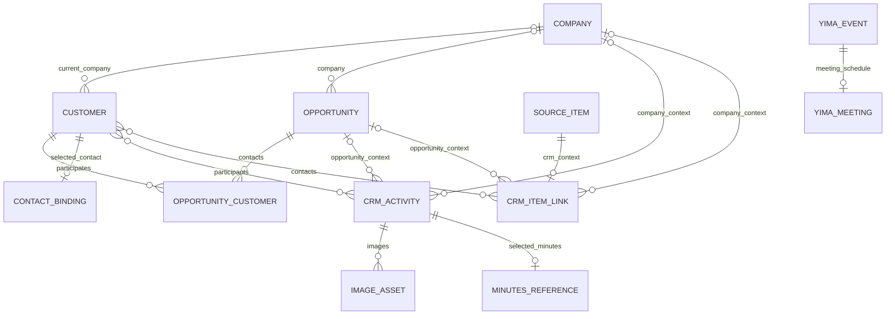

# CRM 首版：单人本地客户管理

## 1. 文档信息与决策状态

- 更新日期：2026-10-16，Asia/Shanghai。
- 产品负责人：Human。
- 状态：单人本地的产品方向、七类能力及 message 的 P2 优先级已由用户确认；本文是功能范围、页面流程和数据关系的设计草案，不代表工程实现或运行验收完成。
- 来源：本轮 CRM 讨论。用户指定公司、客户（关联通讯录）、商机、任务（关联待办）、日历（关联日历）、沟通（关联会议纪要与 message）、相册（从照片添加图片，按时间轴展示往来）。
- 优先级补充：2026-10-16 用户明确只有 message 接入为 P2；会议纪要关联纳入首版。message 指用户主动粘贴或导入消息文本、截图。
- 上位依据：[产品 PRD](../PRD.md)、[个人智能体融合设计](./personal-agent-integration.md)、[Yima 自有日程、待办与会议关联](./yima-owned-calendar-reminders.md)、[DESIGN.md](../../DESIGN.md)。
- 本文作为 CRM 范围增补，不改变既有录音优先、开发与正式容器隔离、会议与日程一对一关系。旧企业 CRM 接入讨论不作为本首版实施依据。

### 已确认与设计建议的区分

| 项目 | 状态 |
|---|---|
| 单人、本地使用；七类能力 | 用户已确认 |
| 客户关联通讯录、任务关联待办、日历关联日历、沟通关联会议纪要、照片往来时间轴 | 用户已指定 |
| message 为 P2，主动粘贴或导入文本、截图 | 用户已确认 |
| 拓展中的 CRM 入口、具体页面组织、商机阶段、存储迁移与关联契约 | 本文设计建议，待评审 |
| 视觉方向 | 复用项目已确认设计系统；2026-10-16 用户已授权按此风格制作可点击 H5 原型 |

## 2. 背景、用户与目标

目标用户是自己维护客户关系的个人。公司的多个联系人、同一客户的多个商机、历次会议与图片资料需要归到可检索的业务上下文中。当前录音中的客户档案主要服务参会人和声纹识别，还没有覆盖完整的客户往来与跟进关系。

首版要支持以下可观察结果：

1. 会前打开客户或商机，能够查看公司、参与人、前序沟通、图片资料与待处理事项。
2. 会后选择已有会议纪要，核对客户与商机归属，保存沟通记录并按需创建跟进任务。
3. CRM 和提醒页打开、编辑、完成的是同一个待办；CRM 和日历入口展示的是同一个日程。
4. 从照片选入的图片保存在本机，能够按往来时间查看，并回到相应客户、商机或沟通。
5. 不连接网络、不授权系统通讯录/日历/提醒事项时，仍可管理本地 CRM、Yima 待办和日程。使用远端模型整理资料属于用户另行发起的操作。

首版验收以一组本地客户、至少一家公司的多个联系人、同一客户的多个商机及一次完整跟进流程为样本，不用录入数量或装饰性报表代替流程验证。

## 3. 功能范围与优先级

“首版”是本次拟定交付范围；P2 表示后续增强，不是数据库中的记录优先级。

| 模块 | 首版范围 | 边界 / 后续 |
|---|---|---|
| 公司 | 新建、编辑、搜索、归档；名称、可选行业/网站/备注；关联客户、商机和往来 | 不自动从相同名称合并公司，不建设工商查询或组织架构 |
| 客户 | 沿用现有客户身份；姓名、联系方式、职位、标签、备注、可选当前公司；从通讯录选择新建或关联，明确刷新字段 | 首版“客户”指自然人联系人；不全量导入通讯录，不自动双向同步 |
| 商机 | 新建、编辑、搜索、归档；关联公司与客户；记录阶段、可选金额/币种/预计日期、需求摘要；查看往来与下一步 | 使用列表和阶段筛选；不做销售预测、漏斗报表、自动评分或看板拖拽 |
| 任务 | 新建或关联 Yima 待办；授权后可选择已有系统提醒事项；查询、编辑、完成和解除关联 | 状态与期限由来源待办管理，不建立另一套 CRM 任务完成状态 |
| 日历 | 新建或关联 Yima 日程/会议；授权后可选择已有系统事件；展示安排并打开来源 | 使用现有日历与日程编辑能力；关联不等于系统同步，不复制会议日程 |
| 沟通 | 手工沟通记录；关联用户选定的已有会议纪要；保存发生时间、参与客户、可选公司/商机、摘要与来源 | 无纪要时可先手工记；不把未生成纪要的录音标为已有纪要 |
| 相册 | 通过系统照片选择器添加图片；核对往来时间、说明和业务归属；按日期展示、预览、移除 | 首版只处理图片，不增加视频、全库扫描、自动人脸归类或 OCR |
| message | **P2**：主动粘贴消息文本，或从文件/照片导入文本和截图；确认时间、方向、参与人和归属后保存 | 不影响首版完成条件；不自动读取短信/iMessage/微信，不建设消息收发客户端 |

通用能力包括本地搜索、关联对象选择、明确保存回执、取消不写入、失败保留输入、归档与解除关联。正式备份恢复、跨设备同步、多人协作、账号、企业 CRM 接入和自动后台跟进不纳入本首版。

## 4. 现有基础与新增边界

以下为源码静态核查，不是运行验收结论。

| 现有能力 | 实现依据 | 本次需要补充 |
|---|---|---|
| 客户档案及声纹关系 | `speech_note/speech_note/Features/Clients/ClientProfile.swift`、`ClientCatalogStore.swift`；本机 `Clients/catalog.json` | 公司实体、通讯录绑定、商机及业务关联；客户身份不能重新编号 |
| 客户管理入口 | `speech_note/speech_note/Features/Home/ContentView.swift` 的管理菜单，融合版仍可达 | 把 CRM 放到可发现的业务入口；现有入口引用同一客户服务 |
| 文稿参会人关联 | `TranscriptDocumentV1.Participant.clientID` | 显式关联沟通/客户，不能根据同名或疑似声纹自动建立业务历史 |
| 本地待办、日程与会议 | `Integration/App/YimaItemsRepository.swift`、`YimaItemsStore.swift` | CRM 业务关联和来源回跳；本地事项不依赖 EventKit 权限 |
| 系统事项展示与编辑 | `SystemRemindersView.swift`、`SystemCalendarModel.swift` | 带来源类型的关联标识、失效检测与重复事件实例识别 |
| 纪要与产物文件 | `RecordingAgentResults.swift`、`tools/VoiceContext/Skill/generate-meeting-minutes/scripts/generate_minutes.py` | 稳定的 CRM 纪要引用、版本与来源校验；当前产物列表没有统一产物 ID |
| 图片选择与文件复制范式 | `CustomExtensionViews.swift`、`RecordingAttachmentStore.swift` | CRM 图片所有权、导入与时间轴；Logo 的 256 px 缩略处理不适用于业务原图 |
| 通讯录 | 当前未找到已接通的客户通讯录服务 | 新增系统选择/授权、字段核对和绑定状态，不把历史权限文案当作已实现 |

## 5. 信息架构与页面职责

2026-10-17 更新：用户确认按“数据和操作复用、各页面按业务范围展示”调整原型。七类能力保持原范围；首页将公司、客户、商机作为主入口，待办、日程和往来以摘要进入共用页面。以下入口组织替代初稿的七个并列模块目录。

入口建议采用“拓展 → CRM（客户管理）”。维持聊天 / 会议 / 提醒 / 拓展四个根 Tab；CRM 是拓展中的业务页面，进入后沿用二级页面隐藏根 Tab 的规则。此入口位置是待评审建议，不改动已有拓展入口排序。

```text
拓展 → CRM
  ├─ 公司列表 → 公司详情 → 编辑 / 关联客户、商机及往来
  ├─ 客户列表 → 客户详情 → 编辑 / 关联通讯录
  ├─ 商机列表 → 商机详情 → 编辑 / 更新阶段
  ├─ 待跟进摘要 → 共用待办列表（CRM 范围）→ 同一待办详情/编辑
  ├─ 下一次约见摘要 → 共用日历（CRM 范围）→ 同一日程/会议详情
  └─ 最近往来摘要 → 共用往来列表（CRM 范围）
       ├─ 沟通筛选 → 沟通详情 → 已有会议纪要 / 手工记录
       └─ 图片筛选 → 图片往来详情 → 图片预览
```

| 页面 | 内容与主要操作 | 返回与关联 |
|---|---|---|
| CRM 首页 | 公司、客户、商机三个主入口；待跟进、下一次约见、最近往来摘要；新增菜单选择业务对象 | 摘要“查看全部”预设 CRM 范围；个人未关联事项不进入摘要 |
| 公司/客户列表 | 搜索名称及可用联系方式，区分同名对象；筛选活动/已归档；新增 | 进入实体详情；公司与客户不混成一种对象 |
| 公司详情 | 基本资料、联系人、商机、待办、日程、沟通和图片往来 | 从此新增时预填公司，保存前仍可核对 |
| 客户详情 | 基本资料、当前公司、通讯录绑定状态；关联商机；未完成任务、将来日程及往来时间轴 | 保留声纹关联入口；不要求先采集声纹才能建客户 |
| 商机列表/详情 | 按阶段筛选；详情显示公司、联系人、需求、可选金额与日期、下一步和时间轴 | 可更新阶段、选择客户、添加沟通/图片、创建任务/日程 |
| 共用待办列表 | 同一组件按 CRM、公司、客户、商机或全部个人待办筛选；显示来源、期限和完成状态 | 详情/编辑/完成使用同一服务；返回保留范围、筛选与位置；正式版提供解除关联 |
| CRM 日历 | 复用既有月/周日历和日程行，只投影当前 CRM 范围；时间待确认的安排单独列出 | 打开同一个 Yima/系统日程；选择已有会议不会再建一个事件 |
| 沟通列表/详情 | 标题、发生时间、客户、商机、正文、图片和纪要来源；区分手工记录与纪要关联 | 可回到会议/录音/所选纪要；来源不可用时仍显示本地记录与状态 |
| 相册时间轴 | 按往来日期分组；图片缩略图、说明、时间依据和关联对象 | 打开图片往来与预览；可修改往来时间、说明和归属 |
| 新建/编辑表单 | 原生 Form；只要求该对象必需字段；业务对象用原生选择页 | 取消不写入；保存成功才退出并刷新原页面 |
| 关联选择页 | 可搜索，显示足以区分同名对象的副标题；核对已选对象 | 返回表单不自动保存；来源权限不足时保留本地选择能力 |

公司、客户、商机详情使用身份、下一步/安排、关联对象、往来和详细资料组织内容。列表“全部”按当前业务对象预设范围；从来源详情返回则恢复原范围与位置。首次进入 CRM 摘要列表必须预设 CRM 范围，不能沿用上次“全部个人待办”而混入私人事项。

### 5.1 功能复用与页面投影

- 待办的 ID、内容、期限、完成状态以及新增/编辑/完成操作共用；CRM 负责业务关系和范围展示。不同入口不会创建另一份待办。
- 日程同样使用既有来源与详情。CRM 范围切换只改变展示，不移动或复制事项。
- 沟通是按公司/客户/商机聚合的往来记录；关联纪要时打开同一个会议资料详情。手工沟通和后续 message 可以独立存在，会议仍负责录音与纪要来源。
- 相册复用往来记录中的图片；从往来列表切换图片筛选，不再为同一图片增加第二条记录。
- 显式从公司/客户/商机入口打开列表时预设对应范围；从待办、沟通或纪要详情返回时保留原范围、完成/类型筛选、搜索和滚动位置。
- 原型评审区提供“全部个人待办”和“会议资料”两个对照入口，用于验证同源数据和详情复用；它们不是新增的拓展产品入口。

## 6. 核心页面流程

### 6.1 公司、客户与通讯录

1. 用户从公司详情新建客户，或在客户列表独立新建；客户姓名必填，公司允许为空。
2. 选择“从通讯录选择”，或在已有客户中选择“关联通讯录”。展示系统联系人选择界面，只接收用户选定的对象。
3. 显示姓名、所选电话/邮箱、职位、公司文字的字段对照；可选择保留 CRM 值或采用所选值。公司文字不自动建立/匹配公司实体。
4. 若同一系统联系人已绑定本地客户，提示打开已有客户；同名或同号码只提示候选，不自动合并。
5. 确认后保存 CRM 客户及绑定，沿用 CRM 自身 UUID。系统联系人标识只用于外部关联。
6. 后续“刷新通讯录资料”仅在可读取该联系人的权限范围内执行，先展示差异再确认；只有选择快照而无持续读取能力时明确显示该状态。

客户编辑不自动写回系统通讯录。未授权、有限访问、联系人不再可读或系统联系人被删除，都不删除本地客户；显示“来源暂不可访问/需重新关联”，不把无法读取直接判断为已删除。

### 6.2 建立商机与安排下一步

1. 在公司或客户详情点击“新建商机”，预填业务上下文；商机至少关联一家公司或一位客户。
2. 填写标题、阶段和需求摘要；金额、币种、预计日期均可不填，不根据沟通内容猜测。
3. 默认阶段建议为“待了解 → 沟通中 → 方案/报价 → 成交 / 失单”，前三级允许往返；失单原因可选。阶段名称属于待评审建议，首版不做自定义工作流。
4. 创建跟进任务或约见日程，复用 Yima 表单并显示当前业务归属；也可选择已有事项。
5. 商机详情和提醒页打开同一事项。客户的下一次跟进从未完成任务计算，不另存一份独立日期。

商机成交/失单不自动完成任务、删除日程或归档联系人；仍有事项时明确展示，由用户处理。

### 6.3 任务与日历关联

1. 从业务详情选择“新建任务/日程”或“关联已有”。默认新建到 Yima 本地来源。
2. 已有来源选择页先展示本地事项；有对应系统访问权限时，允许选择现有 iPhone 提醒事项或日历事件。权限设置沿用“设置 → 日历与待办”，不在 CRM 首页统一索取权限。
3. 保存关联后，CRM 查询来源对象的当前标题、日期和状态。新增事项与关联分别核实回执，不能把来源保存成功等同于关联成功。
4. 在 CRM 编辑或完成事项，通过来源服务操作；从提醒页修改后，CRM 刷新得到同一结果。
5. 会议仍有且只有一个 Yima 日程。已有会议、录音和纪要允许独立补关联；单纯关联纪要不强制新增会议日程。
6. 解除关联只移除业务关系；删除来源事项使用来源的确认流程，并说明实际删除对象。

系统事项关联是对既有对象的引用，不把它自动转为 Yima 对象，也不实现尚未确认的 Yima 与系统双向同步。未知日期保留未安排状态；到期日期、系统通知配置、通知实际送达分别说明，不承诺保存日期后必定提醒。

只读系统列表中的事项可以查看、关联，但编辑、完成或删除操作不可用；明确显示原因，不为获得可编辑状态擅自复制成 Yima 事项。

### 6.4 会后关联会议纪要

1. 从公司/客户/商机详情选择“添加沟通 → 关联会议纪要”；从会议/录音的纪要产物页也可发起“关联 CRM”。
2. 选择确切纪要，预览标题、生成时间、源录音与文稿版本；不能仅选择一个录音 ID 就宣称已关联纪要。
3. 核对沟通发生时间、参与客户、公司和商机。文稿中的明确客户 ID 可作为候选，疑似声纹和同名只作提示。
4. 保存一条沟通记录，保留用户确认的摘要及所选纪要版本引用；一个纪要可关联多位客户，但在同一范围的时间轴只显示一次。
5. 如需整理下一步，用户主动交给助手。助手返回草稿，确认后保存沟通修改或创建任务；没有明确期限的事项不补日期。
6. 回到详情可查看沟通、打开所选纪要和录音，并核对已创建任务。原文与纪要不被 CRM 摘要覆盖。

未生成纪要时显示“暂无会议纪要”，可打开原有整理入口或先手工记录。纪要重新生成、覆盖或文稿修订时标记来源有更新；用户选择更新关联前，不悄悄替换已确认版本。

打开所选纪要时核对受控路径与内容摘要值；不匹配时提示来源已改变，不将当前文件冒充原先选定的版本。用户可明确打开当前来源或更新关联，原已确认摘要保留。首版保存引用和确认摘要，不承诺所有历史纪要全文均有独立存档。

### 6.5 从照片添加图片往来

1. 在相册或业务详情点击“添加图片”，用系统照片选择器选择一张或多张图片。
2. 加载选定图片并显示每项状态；需要从 iCloud Photos 获取但当前不可用时，提示等待或重试，不创建假成功的空图片。
3. 编辑一组图片往来的说明、业务归属和发生时间。首版同一组共享往来时间；不同日期可拆成不同组。
4. 能从选定文件获取拍摄时间时，用它作为可核对候选；否则默认添加时间，并明确时间依据。截图拍摄时间不等于其中对话发生时间。
5. 保存可查看的本地图片副本及索引；原图保留在 Photos。相册按往来时间显示，同一图片往来在客户时间轴中复用同一条记录。
6. 图片可独立属于客户/公司/商机，也可附在一条沟通记录下；后一种情况不再额外生成重复往来。

取消导入不留下可见记录。多图部分失败时逐项说明，可重试失败项；成功项只有在用户确认保存后成为正式记录。移除 CRM 图片只影响本地副本或关联，不修改系统照片。

### 6.6 P2：主动导入 message

用户粘贴文本、从文件导入文本，或选取消息截图 → 核对来源渠道、参与客户、收/发方向和真实沟通时间 → 保存为 message 类型沟通。截图使用同一图片存储和预览能力。

P2 不要求 OCR、自动识别人名/时间、后台读取剪贴板、自动读取其他 App 消息或外部消息 API。无明确消息时间时允许“时间待确认”，不把导入时间伪装成对话发生时间；与首版照片导入的区别是结构化的消息归档语义。

## 7. 数据关系

### 7.1 业务实体

“客户”是自然人联系人，“公司”是组织，“商机”是具体合作机会。三个对象分别拥有稳定 ID；商机阶段不写在客户上。客户可以不属于公司，同一客户可以参与多个商机。



图中 `SOURCE_ITEM` 是带来源类型的引用，不是新增任务/日程副本。业务上下文与下述关联规则共同定义 Activity、ItemLink 到公司、客户和商机的关系。

### 7.2 实体最少字段与权威来源

| 对象 | 最少字段 | 权威来源 |
|---|---|---|
| Company | `id`、名称、可选行业/网站/备注、归档状态、创建/修改时间、版本 | 本地 CRM |
| Customer | `id`、姓名、电话/邮箱、职位、标签、备注、可选 `companyID`、原公司文字、可选声纹 ID、归档状态、创建/修改时间、版本 | 本地客户服务；沿用旧客户 UUID |
| ContactBinding | `customerID`、系统联系人标识、已确认字段快照、读取能力/绑定状态、最近确认时间 | 关联由 CRM 保存；当前系统字段由 Contacts 提供 |
| Opportunity | `id`、标题、可选 `companyID`、关联客户、阶段、需求摘要、可选金额/币种/预计日期、归档状态、版本 | 本地 CRM |
| CRMActivity | `id`、类型（手工/会议纪要/图片/message）、业务上下文、标题、正文或已确认摘要、可选发生时间及时区、时间依据、添加时间、版本 | 本地 CRM；来源原文保持独立 |
| MinutesReference | 所属 Activity、可选 `meetingID`、`recordingID`、文稿 revision、受控存储范围与相对路径、所选产物内容摘要值、标题/生成时间快照 | 具体纪要是来源；CRM 保存所选版本引用 |
| ImageAsset | `id`、`activityID`、私有相对路径、类型、尺寸/大小、完整性摘要、可得的拍摄时间、添加时间、可选照片来源标识 | 已导入本地副本；照片来源标识不作唯一权威 |
| CRMItemLink | `id`、任务/日程来源引用、业务上下文、可选来源沟通 ID、用于失效展示的最小标题快照、版本 | 业务关联归 CRM；事项内容/状态归来源 |
| YimaTodo / YimaEvent / YimaMeeting | 保持现有 ID、完成/日期/会议与录音关系；通过关联服务供 CRM 使用 | 现有 Yima 事项服务 |

新 CRM 对象使用 UUID、明确 `schemaVersion` 和修改版本；正文不保存凭据。客户电话/邮箱设计允许多个值，但旧 `phoneOrEmail` 原文必须保留，不能因无法解析而丢失。

### 7.3 共用业务上下文与约束

Activity 和 ItemLink 使用同一种上下文：零或一家公司、零到多位客户、零或一个商机；至少关联其中一个。商机本身至少关联公司或客户之一。

- 从业务详情创建时预填上下文，保存前可检查；不靠文件名、同名公司或姓名建立关系。
- 关联商机时，其公司与本条显式公司不能冲突；涉及外部顾问等不同公司的联系人可以显式关联。
- 一条沟通可涉及多位客户，但只有一个主要商机；跨多个商机的内容首版由用户拆分或作为无特定商机的沟通保存。
- 一个来源待办/日程在首版拥有一条 CRM 关联，可关联多位客户和一个主要商机。再次选择同一来源时编辑已有关联，不重复建项。
- 客户当前公司变化不会改写历史沟通明确记录的公司，也不会自动调整已有商机归属。
- 公司时间轴聚合明确属于该公司的记录与商机记录，不把联系人全部私人往来都归入其当前公司。
- `meetingID`、`eventID`、`recordingID`、CRM Activity ID 和纪要引用分别存储，不能互换。

### 7.4 系统来源引用

| 来源 | 引用要求 | 读取与失效 |
|---|---|---|
| Yima 待办/日程 | 标明类型并保存稳定本地 ID | 通过现有服务读取、修改；删除后标为来源不可用 |
| iPhone 提醒事项 | 标明 `EventKit reminder`、系统对象 ID、来源/列表 ID | 只在有权读取的范围内查找；权限不足不是删除证据 |
| iPhone 日历 | 标明 `EventKit event`、标识类型与值、来源/列表 ID；重复事件另存确切实例起止时间 | 当前 UI 和 Agent 工具的事件标识不通用；需通过同一适配器解析并核对，不按标题自动重新绑定 |
| 通讯录 | 系统联系人 ID + 选择快照，CRM UUID 独立 | 标识不可解析时允许重新选择并核对，不创建第二个客户 |

系统来源不存在、权限撤销、列表范围变化、标识无法解析分别报告。重新关联必须人工选择，不能用姓名/标题匹配后无提示认领新对象。系统日历首版只关联选定实例，不提供整组重复日程的 CRM 批量关联或编辑器。

## 8. 往来时间轴与派生信息

时间轴是对沟通、图片和来源事项的组合展示，不再保存一份独立事件库。

- **往来**：以沟通发生时间和图片往来时间为主，默认从近到远，按本地日期分组；相同时间使用稳定 ID 排序。
- **待处理/将来安排**：在详情上方单列未完成任务和将来日程，不让未来计划盖住最近一次实际沟通。
- **时间不明确**：单列“时间待确认”，可显示添加时间并明确其含义，不任意落到某一天。
- **来源区分**：任务完成、计划日程、实际沟通、图片分别标明类型；日程到时不代表沟通已经发生。
- **去重**：按 Activity ID 或带来源类型的事项 ID 去重；一条沟通涉及多人、多级范围时，在同一视图只显示一次。沟通附图在该沟通内展示，相册视图可查看这些图片，但不新增第二条往来。
- **最近联系时间**：从有明确发生时间的实际沟通计算；上传图片、修改客户或勾选任务不自动视为联系客户。
- **下一步**：取范围内未完成任务，优先显示最早有期限的任务；无期限任务仍可查看。下一次约见另从将来日程计算，不把日程和待办日期混为一个字段。
- **历史归属**：联系人当前公司变化不重写已记录往来；从公司看关联客户是关系导航，不等于读取该客户所有历史内容。

首版搜索覆盖公司/客户/商机名称及本地文字记录，不进行图片 OCR 搜索或全音频语义检索。

## 9. 技术边界、存储与兼容建议

### 9.1 模块职责

CRM 融合业务放在 `Integration/App`；由统一客户/CRM 服务向 UI 和 Agent 提供结构化操作。录音模块通过 `Integration/Recording` 的明确桥接访问同一客户身份，不从宿主复制一套录音模型，也不要求历史 `1agents_phone` checkout。

建议 CRM 结构化数据采用 App 私有 SQLite 仓库，图片使用独立私有目录；具体 schema 和桥接接口在实现前细化。Yima 事项、录音仓库和聊天存储继续各自负责现有数据，CRM 不直接修改它们的文件。

```text
Application Support/Yima/CRM/
  crm.sqlite
  Images/<assetID>.<extension>
  Thumbnails/<assetID>.<extension>
  Staging/<importID>/...
```

这是拟定目录，不是已存在接口。数据库只存受控相对路径；不持久依赖照片选择器临时 URL，不把原图压成 Logo 尺寸。保存原图可查看的本地版本并单独生成缩略图，需支持常见 JPEG/PNG/HEIC；Live Photo 首版取静态图片。媒体保真、尺寸限制与导入空间估算在技术任务中落实，不默认把整批图片同时载入内存。

图片导入先暂存和验证，再发布文件和提交索引；中断时能够清理未提交暂存与未引用文件，数据库不能把半文件标为可用。重复提交同一次导入不重复创建；用户再次主动选择同一图片可以提示已存在，不按相同文件名覆盖。

### 9.2 旧客户兼容

建议将融合版客户字段纳入统一 CRM 客户服务，现有客户界面与声纹绑定通过适配器访问；融合版只保留一个可写权威源。旧独立录音工程仍可使用原实现，不因融合业务依赖宿主而无法构建。

迁移须满足：

1. 读取旧 `Documents/VoiceContext/Clients/catalog.json`，保留原始文件备份和完整未识别字段；无法解码时报告错误并停止，不按空表覆盖。
2. 在新仓库事务中迁入原客户 UUID、姓名、原联系方式/公司文字、声纹 ID、标签、备注和创建时间；公司文字先保留，不按同名自动批量生成/合并公司。
3. 校验原 catalog 中仍存在的客户数量、ID、声纹关系及相应历史文稿引用迁移后可解析，再记录迁移完成标记并切换融合版的可写服务。迁移前已孤立的 `participant.clientID` 保留原文稿快照，显示“来源客户不可用”，不伪造客户、不阻断其他有效数据迁移；迁移新造成的断链视为失败。
4. 重启或重复执行迁移不增加新客户；切换失败继续使用旧权威源，不让旧 JSON 和新数据库同时接受写入。切换后的后续版本只读新权威数据，旧文件不是第二个实时副本。
5. 新增可选字段兼容旧 schema；遇到不支持的新版本拒绝写入并保留原数据。发布前明确最低可兼容版本与回退限制，不能假定切换后直接运行旧二进制仍能看到新修改。

此迁移是技术建议，实施前需专门评审桥接、备份和回退方案；不在本文直接执行迁移。

### 9.3 事项创建与关联恢复

CRM 与 Yima/系统来源之间不假定跨仓库事务。先保存带 `requestID` 的创建意图，调用来源服务并保存确定返回的对象 ID，再提交业务关联。重试先查询创建回执/已有来源对象，不盲目再建。

来源已创建而 CRM 关联失败时，显示“待办/日程已保存，CRM 关联待处理”，保存恢复记录，提供原对象入口；不会宣称整条流程失败后鼓励重复创建。系统调用结果不明时先核对原请求；无法可靠核实时交给用户确认，不按同标题认领。关联既有事项的操作无需重新保存来源内容。

### 9.4 助手边界

助手查询当前选定客户/商机的结构化资料及用户选定纪要，先返回最少摘要，再按需打开来源。新增、更新、关联和删除通过与 UI 共用的服务，支持请求去重、版本校验与真实回执；不允许通过 shell 直接改 CRM 数据库或 JSON。

用户确认前保留草稿；确认适用的对象与具体修改后才提交。助手不能把未明示的金额、负责人、日期或商机阶段写成事实。远端模型不可用不影响手工 CRM 和本地事项。图片不会因加入相册就自动发给模型，只有用户主动选图交给助手时才按当前模型配置处理。

## 10. 状态、删除与恢复

### 10.1 状态矩阵

| 状态 | 用户看到什么 | 可继续的操作 |
|---|---|---|
| 空数据 | 对应模块暂无记录，保留一个明确新增入口 | 手工新增/选择来源 |
| 加载中 | 原生进度；不以空态代替读取中 | 返回；不重复提交 |
| 本地读取失败 | 明确错误，保留原文件，禁止以空数据覆盖 | 重试/查看诊断；录音继续可用 |
| 离线 | 本地 CRM、已导入图片和 Yima 事项可用；网络来源显示实际状态 | 手工编辑；云端图片待可获取后重试 |
| 通讯录有限/无权限 | 仅选择/读取实际允许的范围；已存客户不消失 | 手工维护、系统选择、设置或重新关联 |
| 日历/提醒权限不足 | 本地事项可用；系统关联显示暂不可访问 | 选本地来源、设置、解除关联 |
| 系统列表只读 | 来源仍可查看与关联，编辑/完成/删除不可用并说明原因 | 查看、解除关联，或另行明确新建本地事项 |
| 图片导入中/部分失败 | 每项状态、成功数量及失败原因；保存前可核对 | 重试失败项或取消；不留下空附件 |
| 保存失败/空间不足 | 保留表单，说明保存对象与失败原因 | 修改/重试，不显示成功 |
| 旧版本表单冲突 | 资料已被另一入口更新，避免覆盖 | 重新载入并核对草稿 |
| 纪要源更新/失效 | 显示所选版本、更新或不可用状态 | 打开原来源、显式替换/解除；保留已确认摘要 |
| 来源事项结果不明/关联失败 | 分别报告来源保存与 CRM 关联结果 | 核对并恢复关联，不盲目重复创建 |

### 10.2 生命周期

- **公司、客户、商机**：默认提供可恢复的“归档”，历史引用仍可查看。永久删除仅在无引用时可直接执行；有引用时列出关联，引导先归档或逐项解除，不级联删除录音、声纹、纪要、待办、日程或系统联系人。
- **旧客户入口**：融合版旧“删除客户”必须调用统一服务并遵守上述引用检查；迁移前既有孤立客户 ID 显示“来源客户不可用”，不崩溃或按同名自动补配。
- **事项关联**：解除 CRM 关联保留来源；删除来源事项后保留不可用标记与最小快照，用户可移除关系。无权限不转为“已删除”。
- **沟通记录**：删除前说明将移除沟通及其 CRM 专属附图；不删除原会议、录音或纪要。关联任务/日程保留，清除指向已删除沟通的关系；所需图片可先另存为独立图片往来。
- **图片**：从沟通/图片往来移除即解除该记录中的图片；没有其他有效引用时清理本地图片与缩略图。清理失败进入可重试状态，不修改 Photos 原图。全部图片移除后删除图片往来前再次确认；普通沟通仍可保留正文。
- **来源权限撤销**：保留用户已选择并保存的本地资料和关系，显示读取受限；用户可主动解除绑定或删除本地资料。

删除与归档文案需写明对象、影响范围及可否恢复；不会把数据库删除描述为立即擦除所有系统备份。

## 11. UI/UX 风格与设计工作

### 11.1 风格复用

- 状态：**已确认复用既有风格**。2026-10-16 用户明确要求按本文制作可点击 H5 原型并沿用现有设计风格；适用规范为 `DESIGN.md`（2026-08-03 基线及截至 2026-10-12 的导航、来源与录音状态增补）的 Typography、Color、Spacing、Layout、Motion、Accessibility、Prohibited Patterns。CRM 页面流程在本轮原型中评审，尚未做 iOS 可用性验收。
- 记忆点：打开一个客户，就能安静、清楚地接上上一次往来。
- 关键词：原生、克制、清楚、可靠、内容优先；反向关键词：彩色仪表盘、卡片墙、装饰渐变、密集销售看板、强制授权。
- 原生与品牌：优先系统字体、NavigationStack、原生 List/Form/Sheet/Menu 与系统选择器；导航与普通操作保持黑白灰，红色沿用录音/破坏性操作语义。
- 信息密度：单列紧凑舒适；实体名称和内容优先，日期、来源与状态为辅助信息；留白和分隔线建立层级。
- 参考：系统通讯录的基本资料、提醒事项的操作、照片的日期分组。拒绝把桌面 CRM 多列工作台搬入 iPhone。
- 图片是内容，允许本身色彩和必要缩略图；外围不增加彩色容器、任意状态胶囊或装饰色。
- 无障碍：Dynamic Type 至少 `.accessibility3`、44 pt 点击范围、深浅色对比度、VoiceOver 读出对象/来源/日期依据；手势有按钮替代；Reduce Motion 使用静态状态。
- 日历复用已批准的自定义月/周视图与红绿点语义，不另换官方月历控件；CRM 图片时间轴不改变录音文稿的排版规则。

### 11.2 设计交付判断

| 工作 | 判断 |
|---|---|
| 产品范围、页面职责、数据关系 | 本文交付，需评审确认新增建议 |
| 页面交互、正常/空/加载/失败/无权限/失效/冲突状态 | 实现前需要局部详细规格；不能只按成功路径编码 |
| 可点击原型 | 2026-10-16 用户已授权制作 H5，重点验证首页、客户详情、商机详情、往来时间轴；输入与评审路径见 [原型说明](./crm-local-first-prototype/README.md) |
| 全新视觉系统 | 不需要，复用既有规范 |
| 无障碍、权限/删除文案、设计走查 | 需要作为实现前输入与交付验收 |
| 系统接入契约、旧客户迁移、媒体恢复 | 需要独立技术细化与必要回归检查 |
| 真机可用性与来源事项核对 | 后续经用户明确授权后在物理设备执行；禁止 Simulator |

## 12. 隐私、权限与平台依据

CRM 数据与图片默认保存在当前 App 私有容器，不主动发布到现有公开文稿目录、不新增应用云同步。开发版和正式版分别管理客户和图片；系统通讯录、提醒事项、日历可能仍是同一设备/账户资料，需在来源界面说明。

通讯录通过用户选择和实际授权范围接入；持续读取须处理有限/完整/拒绝状态。系统权限不是发送联系人资料给模型的授权。实现时需补齐实际使用的权限说明及接入流程。[Apple：访问通讯录](https://developer.apple.com/documentation/contacts/accessing-the-contact-store)、[Apple：联系人选择界面](https://developer.apple.com/documentation/contactsui/cncontactpickerviewcontroller)。

图片只加载用户选定的项目，不要求扫描整个照片库；选取结果还需要实际加载，来自 iCloud Photos 的数据可能在无网络时失败。CRM 保存导入副本后可离线查看，不依赖原图继续存在。[Apple：PhotosPicker](https://developer.apple.com/documentation/photosui/photospicker)。

任务/日历的系统权限、列表绑定和可选同步继续遵守[自有日程与待办设计](./yima-owned-calendar-reminders.md)，本 CRM 关联不将待评审的同步建议改为已批准功能。本地事项保存、系统来源操作和通知分别报告。[Apple：EventKit 隐私与权限](https://developer.apple.com/videos/play/wwdc2023/10052/)。

“本地管理”不等于设备备份永不包含资料，也不等于配置的在线模型在本地推理。用户选定文本/图片交给助手时，应说明实际模型与所选资料范围；不自动读取或上传全量客户、相册、通讯录和消息。相册无需保存 GPS 为 CRM 字段；用户主动分享图片时须核对附件范围和元数据处理，首版不新增后台共享能力。

## 13. 首版验收标准

- [ ] 可建立公司、多位客户和多个商机；公司/自然人/商机身份明确，客户无公司时也能保存。
- [ ] 旧客户 UUID、声纹关系、原始字段与历史参会关联保留；迁移重跑不重复建档，损坏数据不被空表覆盖。
- [ ] 通讯录选择后有字段核对；刷新不静默覆盖 CRM；同名不自动合并，权限撤销不丢客户。
- [ ] 商机阶段、金额/币种和预计日期可选值准确；未知字段不被助手补猜；关闭商机不自动完成来源事项。
- [ ] CRM 与提醒页操作同一 Yima 待办，编辑/完成后相互刷新；下一步从来源状态计算。
- [ ] 关联已有系统事项时来源/标识与日历实例明确；拒绝权限仍可用本地事项，无法读取不误报删除或完成。
- [ ] CRM 日历与会议打开同一个日程，已有会议不重复创建；时间待确认的事项不在某天伪造安排。
- [ ] 会议纪要关联可核对所选产物、录音和文稿版本；原纪要不被覆盖，更新/缺失有说明。
- [ ] 一条沟通关联多位客户，在同一公司/商机时间轴中只显示一次；当前公司变化不改写历史。
- [ ] 可从照片多选图片、核对往来时间与归属；重开 App 后可查看已导入副本，移除不删 Photos 原图。
- [ ] 图片附于沟通时不重复生成时间轴记录；未知时间、拍摄时间、往来时间、添加时间区别清楚。
- [ ] 断网、权限受限、低存储、导入中断、保存失败、来源失效与版本冲突都有保留输入和恢复入口。
- [ ] 来源创建成功但 CRM 关联失败有可核查回执；同一请求重试不盲目生成重复事项/图片/沟通。
- [ ] UI 与助手共用服务；只处理选定业务范围，确认后写入，成功状态与实际数据一致。
- [ ] 归档可恢复，删除/解除关联影响明确；原录音可靠性、四 Tab、现有事项和正式/开发隔离不退化。
- [ ] 深浅色、大字号、VoiceOver、非手势替代和录音期间导航有验收记录；仅静态检查不能替代真机验收。

P2 message 单独验收，不阻塞上述首版：主动粘贴/导入文本、截图可核对来源、方向与沟通时间，按明确归属保存；不要求自动采集、OCR 或发送消息。

## 14. 待评审项与交付顺序

已确认范围不重复询问。后续评审聚焦：

1. CRM 入口名称与首页/详情组织；是否接受“客户为自然人、当前公司至多一家”的首版模型。
2. 商机默认阶段、一个主要商机的关联粒度及金额显示。
3. 接受“通讯录选择/显式刷新、系统事项仅关联”的接入边界；旧客户统一权威源的迁移和回退方案。
4. 图片存储保真、空间限制，以及后续独立备份恢复的范围。

建议交付顺序：页面/状态与关联契约细化 → 客户兼容及公司/商机 → 共用事项关联与恢复 → 纪要沟通与图片时间轴 → Agent 接入、设计走查与验收。message 按 P2 后续增量；不编造工时、发布日期、人员或版本号。

## 15. PM 追踪与本文验证

- 来源 requirement：本轮用户已确认方向，独立 CRM 需求 ID 待登记；PM `#85` 仅作为融合背景，不作为本 CRM 已分派任务。
- 功能蓝图：建议新增“CRM / 公司、客户、商机、任务关联、日历关联、沟通、相册”；message 标记 P2。现有树未核对前不创建或覆盖节点。
- 本地 `.1agents/project_config.json` 开启功能蓝图；2026-10-16 读取项目项时本地 `127.0.0.1:38080` 服务不可达，因此未登记需求/蓝图/任务，不伪造编号或创建隐藏数据。
- 本次交付为设计文档及 PRD/索引关联。工程任务、依赖、里程碑在设计评审与完整现有树读取后增量登记，日期未定。
- 验证方式：核对现有源码与设计依据、检查文档关系/引用/范围一致性；本轮未实现产品代码、未运行 iOS，也不以文档检查勾选产品验收项。

## 16. H5 原型交付（2026-10-16）

用户已要求按本文制作可点击 H5，并沿用现有风格。交付位于 [CRM 原型](./crm-local-first-prototype/index.html)，重点覆盖 CRM 首页、客户详情、商机详情和往来时间轴；[原型说明](./crm-local-first-prototype/README.md)记录点击路径、打开方式、截图和验证边界。

原型将待跟进和将来安排放在业务详情前部，客户页随后展示关联商机，再展示往来与基本资料；这是供本轮评审的页面排序，不视为全部产品交互已经定稿。任务、纪要、手工沟通、图片及阶段操作使用同一组内存演示数据。message 保持 P2。

已完成浏览器关键路径、深浅色、窄屏及键盘关闭检查；本机文件附着的自动化验证受浏览器权限限制，详见原型说明。H5 不读写真实系统资料、不实施客户迁移，也不替代 iOS 工程与真机验收。PM 服务仍不可达，未据原型完成自动关闭需求或创建虚构追踪项。

## 17. 共用页面与业务范围调整（2026-10-17）

用户在评审中指出待办、沟通与现有入口重叠，确认按共用数据和操作、各页面按场景展示的方向调整。

原型首页已将七个并列模块入口收拢为公司/客户/商机及三组摘要。共用待办列表提供业务范围、搜索和完成状态；往来列表提供业务范围及全部/沟通/图片筛选。公司、客户和商机中的“全部待办/日程”预设当前对象，新建时沿用该范围；会议纪要来自同一份资料。另加入一条未关联业务的个人待办，用于验证 CRM 的范围边界。

已通过浏览器核对：全个人范围完成业务待办后 CRM 首页同步变化、私人待办不混入 CRM、客户/公司范围准确、详情返回保留范围与筛选、纪要返回不形成循环，并恢复原时间轴滚动位置。此次仍是 H5 演示，不代表已接入真实 iOS 待办或会议服务。
