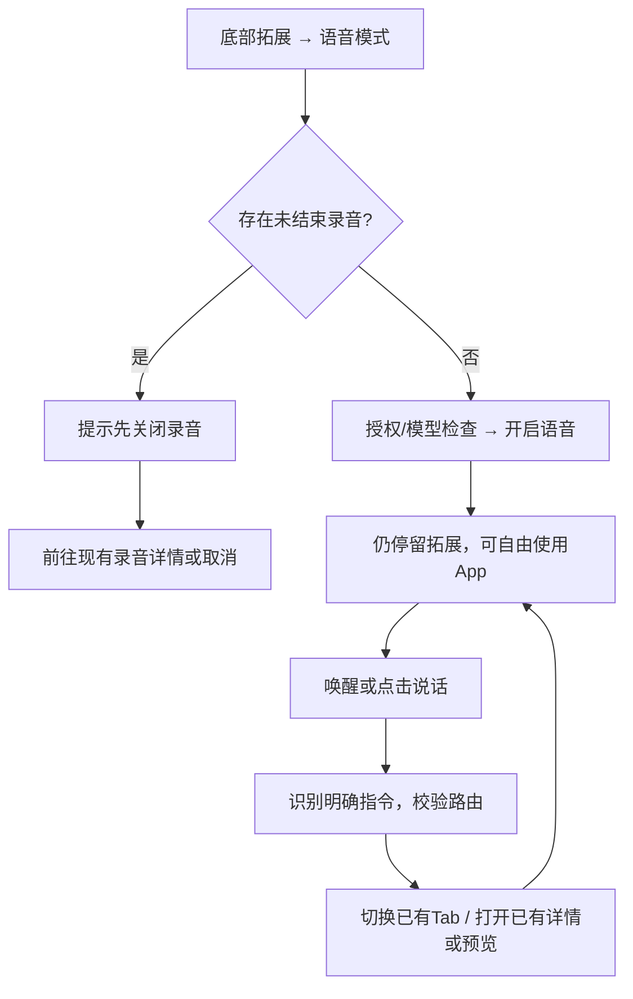

# 小蓝同学：拓展入口与 App 内语音模式

## 1. 文档信息与确认范围

- 更新：2026-10-17，Asia/Shanghai。产品负责人：Human。
- 状态：用户已确认入口、互斥关系与 App 内导航方向；本文为产品与接口设计，尚未实现 iOS 功能。
- 用户已确认：同一台 iPhone，脱离会议独立使用；从底部导航「拓展」开启语音模式；与录音互斥，有录音时提示先关闭录音；不单独设计小蓝前端页面，页面直接在 App 内跳转；保留文字、图片、图表和 HTML 展示能力。
- 本次修订替代先前的聊天首页入口、独立小蓝首页、全屏外壳、常驻底部语音栏和录音中仅暂停独立语音的方案。路径保留，避免已有文档链接失效。
- 上位依据：[产品 PRD](../PRD.md)、[DESIGN.md](../../DESIGN.md)、[统一界面语言](./interface-language.md)、[会中助手](./meeting-voice-assistant.md)。
- [可点击界面稿](./xiaolan-fullscreen-prototype/index.html)改为展示现有 App 导航中的入口、语音操作与互斥提示；使用虚构数据，不能替代原生页面、语音或音频互斥的运行验收。

## 2. 目标、范围与不做

用户从「拓展」明确开启语音模式后，可在 App 中说“小蓝同学，打开今天的日程”，直接到达对应页面，再继续查看或操作内容。语音是跨页面的输入方式，展示由现有 App 页面和预览能力承接。

| 能力 | 设计范围 |
|---|---|
| 入口 | 拓展首页现有网格中的「语音模式」，建议追加到「工具」组；不改变自定义功能优先和其他入口顺序 |
| 独立使用 | 不要求会议、日程或 Recording；前台显式开启，跨 App 内页面保持同一个语音会话 |
| 页面跳转 | 宿主选择已有 Tab、进入已有详情或打开现有内容预览，遵守既有返回路径 |
| 内容展示 | 文字、图片、图表与 HTML 交付到原会话/附件，在 App 内对应预览页打开 |
| 状态与控制 | 原生页头小型麦克风控件与原生菜单，管理暂停、继续、点击说话、停播及关闭 |
| 互斥 | 未结束录音与独立语音不能同时启用；不替用户静默结束录音或切换模式 |

不做独立小蓝首页、独立会话列表、专用全屏导航栈、常驻底部语音栏、第五个 Tab、任意原生 UI DSL、多设备投屏、锁屏/后台监听、自动屏幕截图/OCR、任意第三方 App 控制或全双工语音打断。图片/HTML 可使用现有全屏预览，其他页面按原导航展示，不因开启语音统一隐藏底部导航。

## 3. 从拓展开启与关闭

### 3.1 开启流程

1. 用户点底部「拓展」，在「工具」组点「语音模式」。名称与位置属于现有四列网格，不进入新的小蓝页面。
2. 检查录音生命周期。有任何未结束录音（含暂停、中断待恢复、安全结束尚未完成）时，停在当前页，显示原生提示：
   - 标题：**请先关闭录音**。
   - 说明：**当前有一条未结束的录音。请先结束录音，再开启语音模式。**
   - 操作：**前往当前录音**、**取消**。前者只打开已有录音详情，不自动结束录音或顺便开启语音。
3. 无录音时检查麦克风授权、本地 KWS/ASR 和已配置聊天模型。点击入口即为本次开启意图；必要的系统权限与模型补齐复用现有页面，不额外增加确认步骤。
4. 成功后仍在拓展首页，入口显示可访问的开启状态；页头麦克风控件提示“语音模式：等待小蓝同学”。用户可手动换页或发语音导航。
5. 语音模式已开启时再次点入口，打开原生控制菜单，可暂停、继续、点击说话、停止播报或关闭；不另开设置/对话前端。

录音是否未结束以 `VoiceRecordingWorkspace` / `RecordingCoreModel` 的生命周期为准，不能只检查麦克风是否当前采集或 `AudioSessionCoordinator.isRecording`；暂停录音也需要先结束。现有 `showsRecording` / `showsSessionChrome` 可作为落点，实施前应核对恢复与安全结束状态。

### 3.2 关闭与返回

- 在拓展入口或原生页头菜单点「关闭语音模式」，立即停止监听与当前播报、作废当次回调，保留当前页面和已提交任务。
- 点击页面返回、关闭图片/HTML 预览、切换底部 Tab，只执行既有页面导航，不等同于关闭语音模式。
- 锁屏、进入后台、App 锁定或系统音频中断时释放音频，标记暂停；回前台由原生控件/拓展入口明确恢复，不自动开麦或朗读迟到回复。
- App 重新启动默认语音关闭。会话文字与附件留在既有聊天历史，不新建专门的小蓝历史前端。

## 4. 与录音互斥

| 当前状态 | 用户动作 | 结果 |
|---|---|---|
| 没有录音、语音关闭 | 开启语音模式 | 授权与模型就绪后开启，停留拓展 |
| 录音中 | 开启语音模式 | 提示先关闭录音，语音保持关闭，原录音持续 |
| 录音暂停/中断未结束 | 开启语音模式 | 同样阻止；提示前往原录音结束 |
| 录音正在安全结束 | 开启语音模式 | 尚未完成前阻止；完成后可主动重试 |
| 语音已开启或暂停未关闭 | 开始录音 | 建议对称提示「请先关闭语音模式」，提供「管理语音模式」和「取消」；不自动启录 |
| 两者均关闭 | 开始录音 | 完全遵守现有录音流程 |
| 外部入口/恢复流程出现竞态 | 录音实际取得所有权 | 安全兜底立即回收独立语音，录音保持优先；不恢复独立语音 |

用户已确认互斥和有录音时先关闭录音；反向操作的具体提示文案是本文建议。所有录音入口与语音入口应共用启动门禁，保证最终不会同时占用麦克风；检查、取得所有权与释放必须串行，不能仅靠 UI 禁用按钮。

“关闭录音”映射到现有结束/安全保存流程，不是暂停，也不是删录音。用户结束录音后不自动打开语音模式；关闭语音后不自动开始录音。现有会中助手仍附着原会议录音，不受此次独立入口与前端撤销影响。

## 5. App 内页面跳转

路由由 App 登记稳定 ID、别名、参数与可用状态；语音只向现有导航协调器提交动作，不创建第二套页面栈、重复业务页或嵌套全屏宿主。

| 路由候选 | 示例指令 | 宿主动作 |
|---|---|---|
| `schedule.day` | “打开今天的日程” | 打开提醒中的既有日程视图并选择明确当地日期 |
| `tasks.list` | “打开未完成待办” | 打开既有待办列表，应用已支持的过滤值 |
| `recordings.list` | “打开我的记录” | 切到现有记录/会议列表，不开始录音 |
| `recording.detail` | “打开刚才的录音” | 以真实 ID 打开已有详情；多个候选先选择 |
| `extension.custom` | “打开项目看板” | 以保存的自定义功能 ID 打开既有网页页，重名先选择 |
| `artifact.preview` | “展示那张图片”“打开 HTML 报告” | 打开本会话真实产物的现有预览入口 |
| 原生返回 | “返回上一页” | 调用当前可见页面的原生返回/关闭；当前已在根页时如实告知 |

根页继续显示四个 Tab；详情、工具与既有全屏预览按照 `DESIGN.md` 隐藏 Tab。关闭预览回原来源页。页面权限/表单沿用原生 sheet，显示时暂不接收语音；关闭后恢复此前允许的状态。

固定、无歧义的本地导航可以由宿主在 ASR 后直接匹配，无需联网模型；不确定日期、对象或重名先解释/选择。导航不隐含创建、删除、完成事项或网页提交授权。CRM 等尚未落地的页面不能假称已打开。

## 6. 文字、图片、图表与 HTML

内容交付与页面控制分开。助手可生成/取得内容，交回原聊天会话中的附件或结构化产物，再由 App 打开其内容预览；没有专门的小蓝展示首页或语音外壳。

| 内容 | App 内展示 | 保留的交互与约束 |
|---|---|---|
| 文字 | 既有聊天正文/Markdown 或文档预览 | 阅读、复制、原生返回；默认口头只交付简短结论 |
| 图片 | 既有图片预览/图集 | 放大、缩放、上下张、返回；展示不等于授权上传视觉模型 |
| 图表 | 会话图表产物的预览 | 柱/折线图、标题、坐标、单位、来源、可读数据表；可说“换成折线图”更新同一产物 |
| HTML | 既有 App 内网页预览能力 | 本地作用域 HTML 与资源、页面内交互、原生返回；完整全屏沿用现有网页行为 |

如果某类图表产物目前没有原生 renderer，可增补通用产物预览能力；它属于 App 内容能力，不能据此再造一个“小蓝专用页面”。不同内容类型的预览适配程度必须在实施时核对，不能把界面稿当作它们已接通的证据。

HTML 默认不请求麦克风/相机、不自动播放或调用原生工具，使用受限本地资源。外部登录网页走现有自定义功能及其浏览器会话；开启独立语音时这些网页也不能抢音频。任意 HTML 只保证页面级打开/返回，元素级语音控制需要额外登记，不能自动假定支持。

旧任务完成时内容先落原会话；用户已换页则只提示可查看，不强制跳转或播报。明确点击/语音选择查看后，才通过现有导航打开产物。资源失效、保存失败保留真实错误，不能给空页报成功。

## 7. 语音会话与生命周期

- 不创建 Recording 或持续录音文件；独立 PCM 输入复用 KWS、VAD 和已安装本地 ASR。默认建议“小蓝同学＋指令”，原生菜单的点击说话可省略唤醒词。
- 近期缓存约 3 秒、唤醒后最多等 8 秒开始讲话、指令最长 20 秒、VAD 后约 0.7 秒收尾，沿用现有有界采集参数，实际效果待真机核验。
- 转写、主助手处理和 TTS 时轮流听说；子任务后台执行且主回合结束后可以重新唤起。首版不承诺边播报边声学打断，点击停播后再采集。
- 会话附着 App 级控制器而非单个 View，页面切换不会丢失请求或重新申请麦克风。建议 `source=xiaolan_voice`，复用现有 ChatStore、模型配置和 AgentSessionRunner。
- 会话文字与真实附件保存在既有聊天历史；页面上下文仅传当前路由、选择与最少摘要，不默认截屏、读完整页面或上传图片。
- 关闭模式/后台/中断时释放自己的音频并更新 generation，旧回调不能复活声音或导航；已提交工具业务不能因关闭入口被描述为已撤销。
- 待命音频只本地处理，只有明确指令及必要已选上下文交给配置的模型。是否进一步提供无需唤醒词的连续对话仍待评审。

## 8. UI/UX 复用

- 风格：继承已批准的 `DESIGN.md`（2026-08-03 基线及 2026-10-12 增补）和本轮明确的入口/导航决策。原生、安静、直接、可靠、内容优先。
- 原型输入已确定：现有拓展四列网格、原生页头/菜单/提示、已有业务页及预览；不新增小蓝品牌配色、吉祥物、独立首页、彩色光球、底部语音条或独立关闭外壳。
- 入口建议追加到工具组现有终端/浏览器之后；系统字体、单色图标、12 pt 控制圆角。自定义功能仍排首位，保持其他入口顺序。
- 开启后在可见页的原生工具栏放一个 44×44 pt 麦克风控制，辅助功能名称读出等待/处理中/播报/暂停状态；点按原生菜单。权限和失败用明确文字，不只靠图标颜色。
- 语音状态不遮挡内容。原录音状态控件仅在录音存在时可用，和独立语音控件不会同时处于活动态。
- 内容区按现有 body、metadata、pageInset 20 pt、原生列表 16 pt；深浅色、Dynamic Type 至少 accessibility3、44 pt 点击、VoiceOver 和 Reduce Motion 继续适用。
- 图表有数据表，图片有说明，HTML 有标题和原生返回；任意手势都有按钮替代。
- 原型沿用规范，仅代表设计评审；图表/图片/HTML 的浏览器模拟不能替代 iOS 音频门禁、真实导航与无障碍验收。原型的页面简化不要求重写既有 App 页面。

## 9. 技术落点与接口草案

| 现有位置 | 必要变化 |
|---|---|
| `Integration/App/VoiceContextRootView.swift` | 拓展追加语音入口；App 级语音生命周期与现有导航动作对接，不新增全屏根宿主 |
| `Integration/Recording/VoiceRecordingWorkspace.swift` / `RecordingCoreModel` | 以未结束录音生命周期提供统一互斥检查，包含暂停/恢复/结束中状态 |
| `AudioSessionCoordinator.swift` / `FusionAudio.swift` | 统一录音/独立语音启动门禁、音频所有权与网页媒体抑制；保留录音安全兜底 |
| `MeetingWakeAudioWorker.swift` / `MeetingWakeCommandCapture.swift` | 最小复用 PCM 推理、有界采集；保留会议录音原有路径 |
| `AgentSessionRunner.swift` / `IOSAgentSessionRunner.swift` | 独立 source、工具策略、异步交付和会话文本持久化 |
| `MeetingAnswerUserTool.swift` | 现有仅会议且只接收 text；独立适配不能绕过 source/请求绑定或直接放开所有会话 |
| 已有业务导航、图片/文档/网页预览 | 注册真实路由和产物；复用原生返回、权限层、来源和附件生命周期 |

建议一个拟议工具 `xiaolan_app`，不是当前已有接口：

| action | 输入 | 行为 |
|---|---|---|
| `get_state` | 无 | 最少真实路由、当前产物/版本、选择、可用动作；不默认截图 |
| `navigate` | route、合法 params、expected_revision | 交给 App 导航协调器切 Tab/入详情/开预览 |
| `present` | 真实产物引用或文字/图表数据、expected_revision | 存入当前会话产物，再按明确请求打开对应预览 |
| `back` | expected_revision | 执行当前原生返回/关闭，不操作另一套小蓝历史栈 |

宿主绑定 session/request/generation，不接受模型指定任意文件路径或其他会话。产物有 ID、类型、标题、版本、会话内资源引用；图表加 kind、points、unit、source，不增加任意界面 DSL。

回执区分 accepted/loading/visible/partial/failed/stale。目标真实出现、附件解码/网页加载后才确认 visible；页面已变更则旧 expected_revision 不强行导航。同一请求重复交付去重，业务修改不能因展示失败被重新执行。权限提示由当前可见原生层承接。

持久化使用原 ChatStore 和会话附件目录；业务页直接读取既有权威服务，不复制一套日程/待办数据。语音关闭后保留已保存内容；删除会话只清理独占产物，不删除外部原图或源事项。

## 10. 状态、异常与验收

| 状态 | 呈现与恢复 |
|---|---|
| 未开启 | 拓展入口可用；手动 App 导航正常，不监听环境声音 |
| 等待唤醒 | 原生麦克风控件可读出状态，可点按说话/暂停/关闭 |
| 处理中/播报 | 保留当前 App 页；菜单可关闭或停播，不显示伪完成 |
| 已有未结束录音 | 原生提示先关闭录音，前往详情或取消；录音持续且语音未开启 |
| 语音已开启又启动录音 | 对称提示先关闭语音模式，不自动录音 |
| 缺权限/模型 | 原生解释并复用设置/模型页；补齐后主动重试 |
| 离线 | 已存内容与可确定本地导航可用，远端任务如实失败 |
| 无匹配/重名 | 保留当前页，说明或选择候选，不假造路由 |
| 附件/HTML/图表失败 | 保留源页与已保存资料，显示资源/类型错误和重试 |
| 后台/锁定/中断 | 停止采集与播报；回前台明确恢复，App 重启默认关闭 |
| 迟到结果 | 只落原会话和可查看提示，不抢页、不复活语音 |

- [ ] 从「拓展」开启语音模式后仍在当前 App 页；聊天首页没有新增入口，没有独立小蓝前端。
- [ ] 正在录音、暂停录音、中断恢复和安全结束未完成时均阻止启用；提示前往原录音或取消，无自动结束/启用。
- [ ] 语音已开启时开始录音不会使两者共存；所有入口与竞态有门禁/回收证据。
- [ ] 关闭语音后录音不会自动启动；结束录音后语音不会自动开启。
- [ ] 语音跨 Tab 与详情可用，日程/待办/记录/自定义功能直接进入已有页面，遵守原生返回与 Tab 可见性。
- [ ] 文字、图片、柱/折线图及 HTML 在 App 内容/预览能力中显示；没有重复的小蓝展示外壳。
- [ ] 无权限、离线、对象重名、资源失败、TTS 失败可恢复；不重试不明结果的业务写入。
- [ ] 页面变更、模式关闭及后台后的旧回调不抢屏、不恢复监听或声音。
- [ ] 不产生 Recording/长音频文件；既有会中助手、录音文稿和系统来源权限不退化。
- [ ] 深浅色、窄屏、Dynamic Type、VoiceOver、Reduce Motion 和命中区完成原生验收；浏览器界面稿不勾选这些产品结果。

平台依据保留：[Apple 音频中断](https://developer.apple.com/documentation/avfaudio/handling-audio-interruptions)、[WKWebView](https://developer.apple.com/documentation/webkit/wkwebview)、[图表无障碍](https://developer.apple.com/videos/play/wwdc2021/10122/)。互斥、导航与网页权限隔离是产品要求，不能仅因采用这些系统 API 就视为已实现。

## 11. 交付顺序、待评审与 PM 追踪

本次更新设计文档、PRD、项目设计决策及可点击原型；不实施 App 代码。产品流程、状态/错误文案、权限与保留、无障碍和实施后走查均已考虑；不需要新视觉系统或独立小蓝原型页面。

| 候选工作 | 产出/验收 | 前置 |
|---|---|---|
| 互斥门禁与独立会话 | 未结束录音/语音启动检查、音频所有权、后台关闭；不能同时采集 | 当前确认范围 |
| 拓展入口与原生控件 | 网格入口、原生菜单/冲突提示；开启不跳新页 | 门禁 |
| App 路由与产物预览 | 真实页面注册、原生返回、四类内容适配 | 入口与会话 |
| Agent 联动 | 公开答复、状态摘要、revision/generation、迟到结果 | 路由与内容 |
| 回归与真机验收 | 会议兼容、全入口互斥、失败恢复、设计与无障碍证据 | 上述实现；真机运行需用户明确授权 |

表中仅为设计内候选工作，没有虚构任务 ID、执行人、版本或发布日期。顺序为门禁/会话 → 入口 → 路由/预览 → Agent → 回归。

待评审仅保留：默认唤醒词或连续对话、首批真实路由、反向互斥提示文案与会话保留策略。拓展入口、没有独立小蓝页面、App 内直接导航、有录音先结束等已确认决定不重复询问。

来源 requirement 待登记；功能蓝图建议改为「小蓝语音模式 / 拓展入口、录音互斥、独立会话、App 页面导航、内容预览、交付与恢复」。`.1agents/project_config.json` 开启蓝图，但本轮读取项目项、里程碑和现有树仍因 `127.0.0.1:38080` 连接拒绝失败；未覆盖蓝图、创建隐藏数据或派发工程任务。服务恢复后先核对完整现有树，再增量同步本次确认决策。

验证记录见[原型说明](./xiaolan-fullscreen-prototype/README.md)。本轮不运行 iOS App 或 Simulator，不以文档/浏览器检查冒充原生互斥验收。
