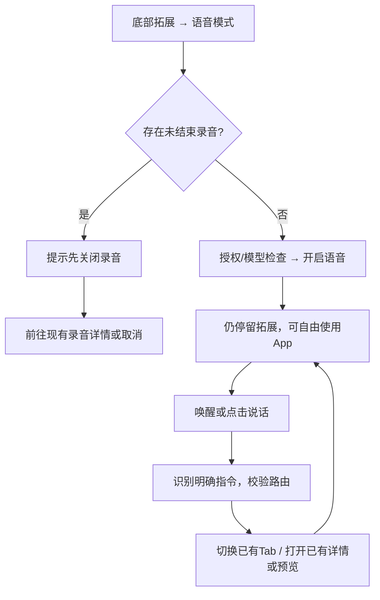

# 小蓝同学：拓展入口与 App 内语音模式

## 1. 文档信息与确认范围

- 更新：2026-10-17，Asia/Shanghai。产品负责人：Human。
- 状态：2026-10-17 已实现独立语音、互斥门禁、App 路由与通用内容预览；签名构建和安装证据见[开发交付记录](../testing/xiaolan-voice-delivery.md)。真机交互及音频效果仍需验收。
- 用户已确认：同一台 iPhone，脱离会议独立使用；从底部导航「拓展」开启语音模式；与录音互斥，有录音时提示先关闭录音；不单独设计小蓝前端页面，页面直接在 App 内跳转；保留文字、图片、图表和 HTML 展示能力。
- 本次修订替代先前的聊天首页入口、独立小蓝首页、全屏外壳、常驻底部语音栏和录音中仅暂停独立语音的方案。路径保留，避免已有文档链接失效。
- 上位依据：[产品 PRD](../PRD.md)、[DESIGN.md](../../DESIGN.md)、[统一界面语言](./interface-language.md)、[会中助手](./meeting-voice-assistant.md)。
- [可点击界面稿](./xiaolan-fullscreen-prototype/index.html)改为展示现有 App 导航中的入口、语音操作与互斥提示；使用虚构数据，不能替代原生页面、语音或音频互斥的运行验收。
- 后续修订：用户已确认跨页单色状态胶囊，支持拖动、靠边收起；新增唤醒/指令本地应答。下文早期页头控件方案由[第 12 节](#12-常驻胶囊与即时应答2026-10-17)替代，既有浏览器界面稿暂不代表本轮胶囊交付。

## 2. 目标、范围与不做

用户从「拓展」明确开启语音模式后，可在 App 中说“小蓝同学，打开今天的日程”，直接到达对应页面，再继续查看或操作内容。语音是跨页面的输入方式，展示由现有 App 页面和预览能力承接。

| 能力 | 设计范围 |
|---|---|
| 入口 | 拓展首页现有网格中的「语音模式」，建议追加到「工具」组；不改变自定义功能优先和其他入口顺序 |
| 独立使用 | 不要求会议、日程或 Recording；前台显式开启，跨 App 内页面保持同一个语音会话 |
| 页面跳转 | 宿主选择已有 Tab、进入已有详情或打开现有内容预览，遵守既有返回路径 |
| 内容展示 | 文字、图片、图表与 HTML 交付到原会话/附件，在 App 内对应预览页打开 |
| 状态与控制 | 原生页头小型麦克风控件与原生菜单，管理暂停、继续、点击说话、停播及关闭 |
| 互斥 | 未结束录音与独立语音不能同时启用；不替用户静默结束录音或切换模式 |

不做独立小蓝首页、独立会话列表、专用全屏导航栈、常驻底部语音栏、第五个 Tab、任意原生 UI DSL、多设备投屏、锁屏/后台监听、自动屏幕截图/OCR、任意第三方 App 控制或全双工语音打断。图片/HTML 可使用现有全屏预览，其他页面按原导航展示，不因开启语音统一隐藏底部导航。

## 3. 从拓展开启与关闭

### 3.1 开启流程

1. 用户点底部「拓展」，在「工具」组点「语音模式」。名称与位置属于现有四列网格，不进入新的小蓝页面。
2. 检查录音生命周期。有任何未结束录音（含暂停、中断待恢复、安全结束尚未完成）时，停在当前页，显示原生提示：
   - 标题：**请先关闭录音**。
   - 说明：**当前有一条未结束的录音。请先结束录音，再开启语音模式。**
   - 操作：**前往当前录音**、**取消**。前者只打开已有录音详情，不自动结束录音或顺便开启语音。
3. 无录音时检查麦克风授权、本地 KWS/ASR 和已配置聊天模型。点击入口即为本次开启意图；必要的系统权限与模型补齐复用现有页面，不额外增加确认步骤。
4. 成功后仍在拓展首页，入口显示可访问的开启状态；页头麦克风控件提示“语音模式：等待小蓝同学”。用户可手动换页或发语音导航。
5. 语音模式已开启时再次点入口，打开原生控制菜单，可暂停、继续、点击说话、停止播报或关闭；不另开设置/对话前端。

录音是否未结束以 `VoiceRecordingWorkspace` / `RecordingCoreModel` 的生命周期为准，不能只检查麦克风是否当前采集或 `AudioSessionCoordinator.isRecording`；暂停录音也需要先结束。现有 `showsRecording` / `showsSessionChrome` 可作为落点，实施前应核对恢复与安全结束状态。

### 3.2 关闭与返回

- 在拓展入口或原生页头菜单点「关闭语音模式」，立即停止监听与当前播报、作废当次回调，保留当前页面和已提交任务。
- 点击页面返回、关闭图片/HTML 预览、切换底部 Tab，只执行既有页面导航，不等同于关闭语音模式。
- 锁屏、进入后台、App 锁定或系统音频中断时释放音频，标记暂停；回前台由原生控件/拓展入口明确恢复，不自动开麦或朗读迟到回复。
- App 重新启动默认语音关闭。会话文字与附件留在既有聊天历史，不新建专门的小蓝历史前端。

## 4. 与录音互斥

| 当前状态 | 用户动作 | 结果 |
|---|---|---|
| 没有录音、语音关闭 | 开启语音模式 | 授权与模型就绪后开启，停留拓展 |
| 录音中 | 开启语音模式 | 提示先关闭录音，语音保持关闭，原录音持续 |
| 录音暂停/中断未结束 | 开启语音模式 | 同样阻止；提示前往原录音结束 |
| 录音正在安全结束 | 开启语音模式 | 尚未完成前阻止；完成后可主动重试 |
| 语音已开启或暂停未关闭 | 开始录音 | 提示「请先关闭语音模式，再开始录音。」；不自动启录 |
| 两者均关闭 | 开始录音 | 完全遵守现有录音流程 |
| 外部入口/恢复流程出现竞态 | 录音实际取得所有权 | 安全兜底立即回收独立语音，录音保持优先；不恢复独立语音 |

所有录音入口与语音入口共用启动门禁，暂停语音也保留模式占用。开始、追录、恢复录音在持久化和音频启动前校验；麦克风授权等待后再次校验，不能仅靠 UI 禁用按钮。

“关闭录音”映射到现有结束/安全保存流程，不是暂停，也不是删录音。用户结束录音后不自动打开语音模式；关闭语音后不自动开始录音。现有会中助手仍附着原会议录音，不受此次独立入口与前端撤销影响。

## 5. App 内页面跳转



路由由 App 登记稳定 ID、别名、参数与可用状态；语音只向现有导航协调器提交动作，不创建第二套页面栈、重复业务页或嵌套全屏宿主。

| 路由候选 | 示例指令 | 宿主动作 |
|---|---|---|
| `schedule.day` | “打开今天的日程” | 打开提醒中的既有日程视图并选择明确当地日期 |
| `tasks.list` | “打开未完成待办” | 打开既有待办列表，应用已支持的过滤值 |
| `recordings.list` | “打开我的记录” | 切到现有记录/会议列表，不开始录音 |
| `recording.detail` | “打开刚才的录音” | 以真实 ID 打开已有详情；多个候选先选择 |
| `extension.custom` | “打开项目看板” | 以保存的自定义功能 ID 打开既有网页页，重名先选择 |
| `artifact.preview` | “展示那张图片”“打开 HTML 报告” | 打开本会话真实产物的现有预览入口 |
| 原生返回 | “返回上一页” | 调用当前可见页面的原生返回/关闭；当前已在根页时如实告知 |

根页继续显示四个 Tab；详情、工具与既有全屏预览按照 `DESIGN.md` 隐藏 Tab。关闭预览回原来源页。页面权限/表单沿用原生 sheet，显示时暂不接收语音；关闭后恢复此前允许的状态。

当前首版由已配置的聊天模型调用全局导航工具；离线仍可手动浏览已有页面与内容，语音导航不承诺离线工作。不确定日期、对象或重名先解释/选择。导航不隐含创建、删除、完成事项或网页提交授权。CRM 等尚未落地的页面不能假称已打开。

## 6. 文字、图片、图表与 HTML

内容交付与页面控制分开。助手可生成/取得内容，交回原聊天会话中的附件或结构化产物，再由 App 打开其内容预览；没有专门的小蓝展示首页或语音外壳。

| 内容 | App 内展示 | 保留的交互与约束 |
|---|---|---|
| 文字 | 通用内容预览 | 纯文字阅读、选择复制、原生返回；默认口头只交付简短结论 |
| 图片 | 复用既有图片缩放组件 | 单图放大、缩放、返回；展示不等于授权上传视觉模型 |
| 图表 | Swift Charts 通用预览 | 柱/折线切换、标题、坐标、单位、来源、可读数据表；重新调用展示工具会保存新产物 |
| HTML | 受限本地 WKWebView 预览 | 同目录本地资源、页面内交互、原生返回；不提供登录浏览器或原生工具桥 |

如果某类图表产物目前没有原生 renderer，可增补通用产物预览能力；它属于 App 内容能力，不能据此再造一个“小蓝专用页面”。不同内容类型的预览适配程度必须在实施时核对，不能把界面稿当作它们已接通的证据。

HTML 默认不请求麦克风/相机、不自动播放或调用原生工具，使用受限本地资源。外部登录网页走现有自定义功能及其浏览器会话；开启独立语音时这些网页也不能抢音频。任意 HTML 只保证页面级打开/返回，元素级语音控制需要额外登记，不能自动假定支持。

旧任务完成时内容先落原会话；用户已换页则安静保存结果，不强制跳转或播报。明确选择查看后，才通过现有导航打开产物。资源失效、保存失败保留真实错误，不能给空页报成功。

## 7. 语音会话与生命周期

- 不创建 Recording 或持续录音文件；独立 PCM 输入复用 KWS、VAD 和已安装本地 ASR。默认建议“小蓝同学＋指令”，原生菜单的点击说话可省略唤醒词。
- 近期缓存约 3 秒、唤醒后最多等 8 秒开始讲话、指令最长 20 秒、VAD 后约 0.7 秒收尾，沿用现有有界采集参数，实际效果待真机核验。
- 转写、主助手处理和 TTS 时轮流听说；子任务后台执行且主回合结束后可以重新唤起。首版不承诺边播报边声学打断，点击停播后再采集。
- 会话附着 App 级控制器而非单个 View，页面切换不会丢失请求或重新申请麦克风。建议 `source=xiaolan_voice`，复用现有 ChatStore、模型配置和 AgentSessionRunner。
- 会话文字与真实附件保存在既有聊天历史；页面上下文仅传当前路由、选择与最少摘要，不默认截屏、读完整页面或上传图片。
- 关闭模式/后台/中断时释放自己的音频并更新 generation，旧回调不能复活声音或导航；已提交工具业务不能因关闭入口被描述为已撤销。
- 待命音频只本地处理，只有明确指令及必要已选上下文交给配置的模型。是否进一步提供无需唤醒词的连续对话仍待评审。

## 8. UI/UX 复用

- 风格：继承已批准的 `DESIGN.md`（2026-08-03 基线及 2026-10-12 增补）和本轮明确的入口/导航决策。原生、安静、直接、可靠、内容优先。
- 原型输入已确定：现有拓展四列网格、原生页头/菜单/提示、已有业务页及预览；不新增小蓝品牌配色、吉祥物、独立首页、彩色光球、底部语音条或独立关闭外壳。
- 入口建议追加到工具组现有终端/浏览器之后；系统字体、单色图标、12 pt 控制圆角。自定义功能仍排首位，保持其他入口顺序。
- 开启后在可见页的原生工具栏放一个 44×44 pt 麦克风控制，辅助功能名称读出等待/处理中/播报/暂停状态；点按原生菜单。权限和失败用明确文字，不只靠图标颜色。
- 语音状态不遮挡内容。原录音状态控件仅在录音存在时可用，和独立语音控件不会同时处于活动态。
- 内容区按现有 body、metadata、pageInset 20 pt、原生列表 16 pt；深浅色、Dynamic Type 至少 accessibility3、44 pt 点击、VoiceOver 和 Reduce Motion 继续适用。
- 图表有数据表，图片有说明，HTML 有标题和原生返回；任意手势都有按钮替代。
- 原型沿用规范，仅代表设计评审；图表/图片/HTML 的浏览器模拟不能替代 iOS 音频门禁、真实导航与无障碍验收。原型的页面简化不要求重写既有 App 页面。

## 9. 已实现的全局工具与路由树

| 现有位置 | 必要变化 |
|---|---|
| `Integration/App/VoiceContextRootView.swift` | 拓展追加语音入口；App 级语音生命周期与现有导航动作对接，不新增全屏根宿主 |
| `Integration/Recording/VoiceRecordingWorkspace.swift` / `RecordingCoreModel` | 以未结束录音生命周期提供统一互斥检查，包含暂停/恢复/结束中状态 |
| `AudioSessionCoordinator.swift` / `FusionAudio.swift` | 统一录音/独立语音启动门禁、音频所有权与网页媒体抑制；保留录音安全兜底 |
| `MeetingWakeAudioWorker.swift` / `MeetingWakeCommandCapture.swift` | 最小复用 PCM 推理、有界采集；保留会议录音原有路径 |
| `AgentSessionRunner.swift` / `IOSAgentSessionRunner.swift` | 独立 source、工具策略、异步交付和会话文本持久化 |
| `MeetingAnswerUserTool.swift` | 现有仅会议且只接收 text；独立适配不能绕过 source/请求绑定或直接放开所有会话 |
| 已有业务导航、图片/文档/网页预览 | 注册真实路由和产物；复用原生返回、权限层、来源和附件生命周期 |

主助手可调用两个全局工具；后台子智能体只向主助手交付产物，不能控制页面。会中助手维持原工具范围，独立语音使用 `source=xiaolan_voice`。

| 工具 / action | 输入 | 行为 |
|---|---|---|
| `app_navigation / tree` | 无 | 返回实际注册路由、参数、父节点和自定义功能的真实名称/ID |
| `app_navigation / get_state` | 无 | 返回当前真实 route、params、revision、can_go_back；不截屏或读取页面全文 |
| `app_navigation / navigate` | route、params（字符串 JSON）、expected_revision | 切 Tab/入详情/开预览，等待目标页面真实挂载 |
| `app_navigation / back` | expected_revision | 执行当前原生返回/关闭 |
| `app_present` | type、title、text/path/chart_json 三选一、expected_revision | 保存会话产物并打开通用预览；文件可指定已验证直属子会话 source_session_id |

```text
chat
└─ chat.session(session_id)
recordings.list
└─ recording.detail(recording_id)
reminders
├─ schedule.day(date: yyyy-MM-dd)
├─ tasks.list(filter: all / incomplete)
└─ reminders.all
extensions
├─ extension.settings / skills / models / soul / memory
├─ extension.mcp / hardware / terminal / browser
├─ extension.custom_functions
└─ extension.custom(id)
artifact.preview(artifact_id)
```

路由树是父子关系和参数契约，不是新增页面栈。`artifact.preview` 的归属节点为聊天，实际关闭仍回到打开它的来源页。`tasks.list` 是仅待办的列表，`reminders.all` 承接原全部事项；日程与待办仍读取原权威数据。

宿主绑定 session/request/generation。文字最多 50000 字符，图表最多 500 个有限、不重名数据点且必须给出来源；HTML 主文件最多 2 MiB、图片最多 32 MiB/4000 万像素。文件限定当前会话或真实直属子会话的 workspace/attachments，校验穿越和符号链接；重开时重新验证所属会话。图表包含 kind、points、unit、source，不增加任意界面 DSL。

回执区分 visible、failed、stale、busy、unavailable、invalid_arguments 等状态。目标真实出现、图片解码/网页加载后才确认 visible；页面已变更则旧 expected_revision 不强行导航。内容保存成功但展示失败时明确返回 saved=true 和失败状态。业务修改不能因展示失败被重新执行。权限提示由当前可见原生层承接。

持久化使用原 ChatStore 和会话附件目录；业务页直接读取既有权威服务，不复制一套日程/待办数据。语音关闭后保留已保存内容；删除会话只清理独占产物，不删除外部原图或源事项。

## 10. 状态、异常与验收

| 状态 | 呈现与恢复 |
|---|---|
| 未开启 | 拓展入口可用；手动 App 导航正常，不监听环境声音 |
| 等待唤醒 | 原生麦克风控件可读出状态，可点按说话/暂停/关闭 |
| 处理中/播报 | 保留当前 App 页；菜单可关闭或停播，不显示伪完成 |
| 已有未结束录音 | 原生提示先关闭录音，前往详情或取消；录音持续且语音未开启 |
| 语音已开启又启动录音 | 对称提示先关闭语音模式，不自动录音 |
| 缺权限/模型 | 原生解释并复用设置/模型页；补齐后主动重试 |
| 离线 | 已存内容可手动浏览；依赖远端模型的语音任务如实失败 |
| 无匹配/重名 | 保留当前页，说明或选择候选，不假造路由 |
| 附件/HTML/图表失败 | 保留源页与已保存资料，显示资源/类型错误和重试 |
| 后台/锁定/中断 | 停止采集与播报；回前台明确恢复，App 重启默认关闭 |
| 迟到结果 | 只落原会话和可查看提示，不抢页、不复活语音 |

- [ ] 从「拓展」开启语音模式后仍在当前 App 页；聊天首页没有新增入口，没有独立小蓝前端。
- [ ] 正在录音、暂停录音、中断恢复和安全结束未完成时均阻止启用；提示前往原录音或取消，无自动结束/启用。
- [ ] 语音已开启时开始录音不会使两者共存；所有入口与竞态有门禁/回收证据。
- [ ] 关闭语音后录音不会自动启动；结束录音后语音不会自动开启。
- [ ] 语音跨 Tab 与详情可用，日程/待办/记录/自定义功能直接进入已有页面，遵守原生返回与 Tab 可见性。
- [ ] 文字、图片、柱/折线图及 HTML 在 App 内容/预览能力中显示；没有重复的小蓝展示外壳。
- [ ] 无权限、离线、对象重名、资源失败、TTS 失败可恢复；不重试不明结果的业务写入。
- [ ] 页面变更、模式关闭及后台后的旧回调不抢屏、不恢复监听或声音。
- [ ] 不产生 Recording/长音频文件；既有会中助手、录音文稿和系统来源权限不退化。
- [ ] 深浅色、窄屏、Dynamic Type、VoiceOver、Reduce Motion 和命中区完成原生验收；浏览器界面稿不勾选这些产品结果。

平台依据保留：[Apple 音频中断](https://developer.apple.com/documentation/avfaudio/handling-audio-interruptions)、[WKWebView](https://developer.apple.com/documentation/webkit/wkwebview)、[图表无障碍](https://developer.apple.com/videos/play/wwdc2021/10122/)。互斥、导航与网页权限隔离是产品要求，不能仅因采用这些系统 API 就视为已实现。

## 11. 交付顺序、待评审与 PM 追踪

用户已授权开发并部署到当前设备。本次完成上述 App 代码、宿主逻辑检查与签名构建；安装和未完成验收分别记录在[开发交付记录](../testing/xiaolan-voice-delivery.md)，不以浏览器原型替代原生验收。

| 候选工作 | 产出/验收 | 前置 |
|---|---|---|
| 互斥门禁与独立会话 | 未结束录音/语音启动检查、音频所有权、后台关闭；不能同时采集 | 当前确认范围 |
| 拓展入口与原生控件 | 网格入口、原生菜单/冲突提示；开启不跳新页 | 门禁 |
| App 路由与产物预览 | 真实页面注册、原生返回、四类内容适配 | 入口与会话 |
| Agent 联动 | 公开答复、状态摘要、revision/generation、迟到结果 | 路由与内容 |
| 回归与真机验收 | 会议兼容、全入口互斥、失败恢复、设计与无障碍证据 | 上述实现；真机运行需用户明确授权 |

表中仅为设计内候选工作，没有虚构任务 ID、执行人、版本或发布日期。顺序为门禁/会话 → 入口 → 路由/预览 → Agent → 回归。

首版默认“小蓝同学＋指令”，菜单提供省略唤醒词的点击说话；连续对话仍不在范围内。首批路由和反向互斥提示已落地。拓展入口、没有独立小蓝页面、App 内直接导航、有录音先结束等已确认决定不重复询问。

来源 requirement 待登记；功能蓝图建议改为「小蓝语音模式 / 拓展入口、录音互斥、独立会话、App 页面导航、内容预览、交付与恢复」。`.1agents/project_config.json` 开启蓝图，但本轮读取项目项、里程碑和现有树仍因 `127.0.0.1:38080` 连接拒绝失败；未覆盖蓝图、创建隐藏数据或派发工程任务。服务恢复后先核对完整现有树，再增量同步本次确认决策。

原型验证记录见[原型说明](./xiaolan-fullscreen-prototype/README.md)，本轮开发验证见[开发交付记录](../testing/xiaolan-voice-delivery.md)。未运行 Simulator；安装成功与真机语音/界面验收分开记录。

## 12. 常驻胶囊与即时应答（2026-10-17）

### 12.1 本轮确认与 UI/UX 风格

用户反馈原功能已可使用，提出统一跨页常驻状态、浮窗拖动靠边隐藏，以及两种立即口头应答；随后明确选择「单色小胶囊，显示麦克风和简短状态」。该选择替代前文分散在页头的语音控件，不改变拓展入口、录音互斥、已有导航和无独立小蓝前端的决定。

UI/UX 风格已确认：继续复用 `DESIGN.md` 的安静、原生、单色、内容优先和可靠状态，使用系统字体、语义底色/文字与 12 pt 控制圆角。保持克制阴影，不用彩色光球、装饰渐变、吉祥物或底部常驻语音栏。此次为既有风格下明确选定的控件变更，不再启动独立低/高保真原型任务；实施后仍须原生走查。决策人：Human，2026-10-17；跨页挂载和音频细节属于实现选择。

### 12.2 位置、收起与操作

- 在 App 当前场景中只保留一份胶囊；语音开启/暂停期间跨 Tab、详情、普通原生 sheet、全屏网页与内容预览显示。默认右侧中部，避开页头、底部导航、输入区和键盘；拖动后记住左右侧及相对高度，尺寸改变时重新约束。
- 拖向左/右边缘可收起，仍露出恢复把手；点击把手只展开，不自动开麦、恢复或执行指令。收起状态不等于暂停，语音运行状态须可通过图标和辅助功能读取。
- 展开胶囊显示麦克风和短状态；点击使用原生菜单，保留点击说话、暂停、继续、停止播报和关闭。菜单也提供靠边收起，VoiceOver 提供移动/展开动作作为拖动替代。
- 后续文案确认（同日）：胶囊文字及其菜单状态标题统一使用两个字：**待机、聆听、识别、处理、播报、暂停、我在、收到**。「收到，开始处理」的屏幕短状态为「收到」，口头应答保留完整原句；无障碍说明和错误详情保持完整语义。
- 关闭语音时移除胶囊；进入后台/锁屏/App 锁定和隐私权限提示时隐藏。普通表单保留「已暂停」控制，但继续和点击说话受现有表单门禁约束；不允许浮窗绕过权限、App 锁或编辑流程。
- 只有控件自身接收点击，空白区域透传；不抢键盘焦点，不建立另一套业务导航。保留 44 pt 点击区域、Dynamic Type、浅深色对比度和 Reduce Motion。靠边时为原生返回手势留出空间。

### 12.3 两种本地口头应答

VAD 负责断句，ASR 才产生文字。独立语音在约 0.7 秒 VAD 静音后将完整唤醒话语交给 ASR，移除开头唤醒词、空白和标点，再判断剩余内容。不能用总字数大于 5 作为硬条件，否则「小蓝同学，回」等短指令会被吞掉。现有 ASR 同音唤醒词「小兰同学」沿用兼容。

| 识别结果 | 口头反馈 | 后续 |
|---|---|---|
| 只有「小蓝同学」及标点/空格 | **我在** | 不创建会话或调用模型；说完短暂等待下一句，无需再说唤醒词，8 秒无指令返回待命 |
| 唤醒词后有任何实际指令，含短指令 | **收到，开始处理** | 本地反馈后把已识别指令交给原 Agent，一次提交，最终仍按真实工具结果答复 |
| 点击说话或上一句唤醒后的直接指令 | **收到，开始处理** | 同一原 Agent 流程 |
| 只有静音、噪声、标点或 ASR 为空/失败 | 无「我在」或接单应答 | 保留现有超时/失败恢复，不能伪造识别成功 |

两句话由本地中文语音合成触发，不等待模型或网络 TTS；正常任务结果继续使用配置的输出服务。这里的「立即」指分类完成后立即走本地播报，不承诺消除 VAD、ASR 或系统音频启动耗时。遵守现有静音偏好；静音时显示状态，不强行外放。模型提示明确宿主已反馈，避免再次重复「收到」。

口头反馈期间停止麦克风采集，完成后才开始下一轮监听或执行任务，避免把自己的声音当作新指令。停止播报、暂停、关闭、后台和中断均可取消；迟到合成/播放回调不得重开麦克风、导航或提交任务。反馈失败不重新执行业务指令，UI 保留真实错误。

独立语音的「仅唤醒词也及时断句」为显式开关；会议原有唤醒后等待指令行为保持。整体仍为有界内存音频，不增加持续录音文件。

### 12.4 验收与追踪

- 主机逻辑验证：唤醒词/标点/同音词、单字指令、静音点击、VAD 断句、迟到 PCM/ASR、反馈取消/超时、仅唤醒不调模型、直接等待超时、关闭时不提交/不复活、旧会议行为。
- UI 静态与几何验证：单实例、正常/窄屏/旋转/键盘约束、靠边可恢复、44 pt 目标、空白透传与旧页头控件移除；SDK 编译确认接口。真机触摸和 VoiceOver 效果不得以主机检查代替。
- 技术实现顺序：音频分类与本地反馈可并行；已确认形态后接入场景级胶囊；再合并构建、开发包签名与安装。无用户给定日期，不另编里程碑日期。
- PM 本轮已检查 CLI、项目开关及现有树读取；`featureCatalogEnabled=true`，但 `project-items list` / `feature-catalog list` 均被本地 `127.0.0.1:38080` 连接拒绝阻断。没有虚构项目项、蓝图或任务 ID；服务恢复后再按现有结构增量关联本节。

## 13. 共用运行时与配置策略

小蓝与 Yima 保持独立身份、提示词与会话，复用同一 Agent 引擎。角色差异由应用配置和策略描述，不在运行时按身份判断。小蓝复杂任务沿用 `spawn_subagent`，子任务通过 `async_task_notice` 二次唤醒原会话，再实际调用 `answer_user` 交付结果；不再转交 Yima 主会话。已有图文、图表、HTML 预览继续支持真实直属子会话资源。见[智能体分工](./xiaolan-yima-agent-roles.md)和[运行时策略设计](../architecture/agent-runtime-policies.md)。
