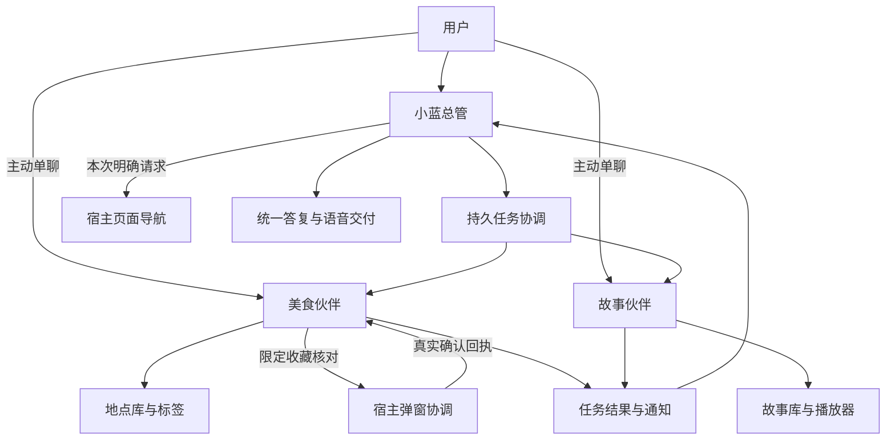

# 小蓝总管与专业伙伴：设计及改造方案

## 1. 文档信息与决策状态

- 日期：2026-10-20；产品决策人：Human。
- 状态：角色、上下文、单聊及权限边界已由用户确认；以下接口、交互细节和拆分顺序为改造提案，尚未实现。
- 来源：本次对话。用户要求先整理方案，本轮只交付文档，不启动架构代码改造、原型、构建或设备运行。
- 相关基线：[现有小蓝与 Yima 分工](xiaolan-yima-agent-roles.md)、[运行时策略](../architecture/agent-runtime-policies.md)、[美食地图](food-map.md)、[故事机](children-story-player.md)。
- PM：项目启用了功能蓝图；当前看板服务不可用，需求、功能、任务与里程碑尚未登记。第 15 节使用文档内草案代号，不是 PM 编号。

### 用户已确认

1. 小蓝是通用总管，平时统一接收需求、安排专业伙伴、整理结果并回复用户。
2. 首批固定两个专业伙伴：美食伙伴、故事伙伴。伙伴具有稳定身份，不是每次任务新建的临时执行器。
3. 每个伙伴保留自己的上下文和长期记忆，能够继续处理同类任务；用户也能与它单独聊天。
4. 智能体的页面跳转权限暂时只给小蓝。
5. 专业伙伴可以发起业务弹窗；首个明确场景是美食伙伴打开收藏地点核对弹窗。
6. 收藏核对继续展示名称、完整地址、地址下方的位置地图及标签，用户点击确认后才保存。
7. 用户只要求收藏、修改标签等业务操作时，完成后不自动跳页；明确要求查看或导航时才安排页面操作。

“页面跳转只给小蓝”约束智能体发起的操作。用户仍可直接触摸地图、列表、返回和导航按钮，不必经过小蓝。

### 本方案采用的工程默认值

复用现有 Agent 运行时、伙伴身份、主会话、记忆、通知和原生业务数据；新增最少的任务协调与授权契约。一个伙伴串行处理任务，不同伙伴可以并行；同一时刻只出现一个业务弹窗。具体入口和状态文案在实施前的交互稿中核对。

## 2. 目标、边界与成功标准

用户只需对小蓝说“收藏这家店”或“播放之前那个故事”。相关伙伴能结合自己的历史继续工作，小蓝依据真实回执交付结果。需要用户决定时，伙伴可在当前页面发起限定弹窗；无需先打开业务页面。

“常驻”指身份、会话、记忆和任务记录持久保留，执行按需唤起。它不表示无限上下文、模型一直运行，或 iOS 进程被结束后仍可监听。

本轮方案不扩展到任意伙伴市场、自动创建专业伙伴、伙伴相互自由派单、群聊编排、跨设备同步、新的语音首页或第五个 Tab。沿用既有模型设置，不为三个角色强行指定不同模型。现有录音互斥、锁屏完整智能体、后台音频和数据保护规则继续适用。

顶层验收结果：同一个美食伙伴可以在小蓝委派与用户单聊间延续已确认偏好；每次收藏仍需原生确认；只有小蓝能按本次明确请求打开地图或苹果地图；故事伙伴使用真实故事库和播放器，结果由当前交互渠道交付，任务不丢失、不重复操作或播报。

## 3. 角色与职责

| 角色 | 主要责任 | 持续保留的内容 | 默认交付渠道 |
|---|---|---|---|
| 小蓝总管 | 理解需求、必要追问、分配任务、协调跨领域工作、统一回复、执行授权的页面跳转 | 总管主会话、任务关系、必要的结果摘要；长期记忆尊重原有开关 | 原用户会话；语音入口由宿主统一播报 |
| 美食伙伴 | 查找真实地点、消除分店歧义、收藏核对、标签维护、读取收藏 | 自己的主会话、已确认饮食/地点偏好；业务事实读取地点库 | 委派时回传小蓝；单聊时直接在自己的会话回复 |
| 故事伙伴 | 查询故事库、匹配标题、控制播放、结合历史偏好处理后续请求 | 自己的主会话、已确认故事偏好；实际播放状态读取播放器 | 委派时回传小蓝；单聊时直接回复，播放由宿主控制 |
| 临时执行器 | 有界检索、资料处理等一次性工作 | 当前任务上下文及产物，沿用既有清理规则 | 只向父任务返回结果 |

专业伙伴对本领域业务负责；临时执行器不取代伙伴，也不能保存伙伴长期记忆、发起弹窗或控制页面。首期伙伴不再向其他常驻伙伴转派任务，跨领域协调回到小蓝。

## 4. 现状与需要补齐的部分

以下为当前工作区静态审计结果，不能当作新架构已交付。

| 已有基础 | 当前限制 | 改造方向 |
|---|---|---|
| `AgentProfile`、`AgentStore.openMainSession`、`send_agent_message` | 常驻身份存在，但美食与故事目前仍主要是小蓝直接调用的宿主工具；语音白名单未开放伙伴派单 | 配置固定专业身份，为小蓝开放受限的伙伴投递 |
| 伙伴主会话与 `agent-relay` | 目标忙时默认拒收，显式 interrupt 才中断；缺少专业任务持久队列 | 统一接收单聊与委派任务，串行执行、独立回执 |
| 小蓝有独立身份和语音会话 | 关闭/重新启用语音会清空当前会话绑定，非稳定总管主会话；其新身份默认长期记忆关闭 | 小蓝也绑定可复用主会话；每次激活的执行和页面授权仍独立生成 |
| 原始历史、压缩摘要、按 Agent 隔离的长期记忆 | 摘要会损失细节；任务内容不会自动共享到另一伙伴 | 明确交接信息与事实来源，保留可检索原文，不共享全量历史 |
| 持久化 `AsyncTaskNoticeManager` | 是结果通知与去重机制，不是待执行任务队列；普通完成通知只允许回复 | 复用通知，另补任务状态；授权续办不能直接放宽所有 notice |
| 地点查询、收藏库及确认弹窗 | 候选 ID 绑定搜索会话；小蓝不能复制伙伴会话的候选 ID 来展示/导航 | 宿主登记只读地点结果引用，收藏仍在候选所属会话确认 |
| `app_navigation`、`app_present`、业务工具 | 权限主要按 source/运行角色配置；多个工具动作能改变页面 | 引入真实身份与动作级权限，在列工具和实际执行时双重检查 |
| 故事播放器、完播通知、后台语音链 | `story_player` 目前只接受有效 `xiaolan_voice` 主请求 | 接受可信故事伙伴任务授权，继续校验取消、代次、实际状态与音频所有权 |

主要代码锚点：

- 配置与工具白名单：[`VoiceAgentConfiguration.swift`](../../Integration/App/VoiceAgentConfiguration.swift)、[`VoiceAgentPrompt.swift`](../../Integration/App/VoiceAgentPrompt.swift)。
- 常驻身份与投递：[`AgentProfile.swift`](../../Vendor/Phone/src/apple/Domain/AgentProfile.swift)、[`AgentStore.swift`](../../Vendor/Phone/src/ios/AgentKit/AgentStore.swift)、[`AgentDirectoryCoordinator.swift`](../../Vendor/Phone/src/ios/AgentKit/AgentDirectoryCoordinator.swift)。
- 历史和记忆：[`AIChatViewModel+Compaction.swift`](../../Vendor/Phone/src/ios/Agent/Chat/AIChatViewModel+Compaction.swift)、[`AIChatViewModel+Persistence.swift`](../../Vendor/Phone/src/ios/Agent/Chat/AIChatViewModel+Persistence.swift)、[`AIChatViewModel+MemoryTools.swift`](../../Vendor/Phone/src/ios/Agent/Chat/AIChatViewModel+MemoryTools.swift)。
- UI 和业务：[`AppNavigationTool.swift`](../../Integration/App/AppNavigationTool.swift)、[`AppPresentationTool.swift`](../../Integration/App/AppPresentationTool.swift)、[`YimaPlacesAgentTool.swift`](../../Integration/App/YimaPlacesAgentTool.swift)、[`YimaPlacesSaveConfirmation.swift`](../../Integration/App/YimaPlacesSaveConfirmation.swift)、[`StoryPlayerTool.swift`](../../Integration/App/StoryPlayerTool.swift)。

## 5. 总体结构与交付方式

默认委派路径中，小蓝说明已开始或正在等待核对，然后结束当前模型轮次。伙伴完成后回传真实结果，小蓝再交付；“已受理”“弹窗已展示”“已保存”是不同状态，不能合并成成功。

单聊不强制绕回小蓝才可完成业务：用户在美食伙伴会话内提出收藏，伙伴可自行查找并发起同一核对弹窗，确认后在该会话回复。页面跳转仍需交给小蓝。单聊默认使用文字回复，不因伙伴运行而开启第二路 TTS。

所有委派记录标明“小蓝委派”和来源任务；单聊标明真实用户输入。消息显示和推理上下文都保留来源，不能把伙伴转述伪装成用户刚刚授权。现有 relay 可复用传输能力，但不能仅凭消息正文的“用户同意”授予权限。

## 6. 关键用户流程

### 6.1 通过小蓝收藏地点

1. 用户：“收藏杭州河畔面馆文一路店，标签是想去。”（示例为虚构店名。）
2. 小蓝将名称、区域、明确标签、任务目标交给固定美食伙伴；不附送无关会议、故事或完整聊天记录。
3. 美食伙伴查询真实地点。分店不唯一时提出一个澄清问题，经小蓝转达；用户回答以原任务 ID 续办，不另建伙伴。
4. 唯一地点确定后，美食伙伴申请 `place_save_confirmation` 弹窗。宿主在当前页面展示名称、完整地址、位置地图及最终合并标签。
5. 用户点击确认，宿主重验候选、任务及收藏版本并原子保存；取消、超时、失效或失败不写入成功记录。
6. 美食伙伴将保存回执、真实收藏 ID 和结果摘要交给小蓝，小蓝回复结果，保持当前页面。

如果用户最初明确说“收藏后在地图上给我看”，小蓝还持有这一展示意图。确认成功后须走第 8 节的受限续办，重新核验页面状态后展示；保存本身不产生跳页授权。

### 6.2 查找后展示，或启动苹果地图

美食伙伴负责地点匹配；小蓝接收宿主验证过的只读结果引用，按用户本次“在地图上看看”或“导航过去”的要求执行。地点不唯一先澄清；候选失效重新查询，收藏被删重新读取。跳到 App 地图与打开苹果地图是两种明确动作，前者不能自动升级为后者。

### 6.3 故事与连续请求

“播放之前喜欢的故事”交给故事伙伴，先读真实库和状态，再结合自身历史消除歧义。播放执行回执必须区分准备中、等待语音结束、播放中、暂停与完成。小蓝只按实际状态回复，不把“准备播放”说成已出声。

播放后“换一个”“从刚才那里继续”结合当前播放器状态与故事伙伴上下文处理。自然完播只记事实，不等于用户要求续播。播放来源同时关联业务任务、故事伙伴和公开交付会话，完播不向两个会话各播报一次。

### 6.4 伙伴单聊与切回小蓝

同一伙伴的单聊与委派首期复用同一个长期主会话，以便直接续谈；输入按第 9 节串行。小蓝只收到与委派任务相关的摘要，不自动读出用户全部单聊。用户回到小蓝说“刚才美食伙伴提到的那家”，由任务记录定位相关结果，确实没有关联时先澄清。

在伙伴单聊里提出“打开地图”，伙伴可提供“让小蓝打开地图”的显式操作。用户点击后由宿主创建新的小蓝请求，绑定当前页面和真实结果引用；伙伴不能改写自己的身份调用导航。该交接的具体控件位置属于交互稿提案。

## 7. 页面跳转与弹窗：分开的权限

### 7.1 目标权限矩阵

所有“允许”均受本次用户任务、实际身份、取消状态和业务权限约束；不是永久自由执行权。

| 能力/动作 | 小蓝 | 美食伙伴 | 故事伙伴 | 临时执行器 / 普通完成通知 |
|---|---|---|---|---|
| 读取与维护自己的上下文/长期记忆 | 允许，尊重开关 | 允许 | 允许 | 执行器沿用只读父记忆；通知只交付 |
| 派发固定专业伙伴任务 | 允许 | 首期不开放 | 首期不开放 | 不开放 |
| 查地点、读收藏、标签维护 | 经伙伴处理；迁移期兼容旧路径 | 允许 | 不开放该业务工具 | 首期不开放该业务工具 |
| 收藏写入 | 由伙伴核对后保存 | 仅真实确认后保存 | 不开放 | 不开放 |
| 地点核对弹窗 | 可协调，不另建一套 | 允许指定类型 | 不开放该类型 | 不开放 |
| 故事库查询与播放控制 | 经伙伴处理；保留当前停止能力至迁移验收 | 不开放 | 允许受控动作 | 不开放 |
| `app_navigation.navigate/back` | 允许，须明确意图及当前页面授权 | 不开放 | 不开放 | 不开放 |
| `app_present` 内容预览 | 按页面跳转管理 | 只返回产物引用 | 只返回产物引用 | 只返回产物引用；通知不能展示 |
| `yima_places.show/navigate`、`yima_items.open`、外部地图打开 | 仅小蓝可发起 | 只交地点结果或意图 | 不开放 | 不开放 |
| 任意系统页面、URL、浏览器或脚本改变用户界面 | 不由角色默认授予，遵守同一导航检查 | 不得作为旁路 | 不得作为旁路 | 不得作为旁路 |

伙伴可“打开弹窗”指宿主认可的业务弹窗类型。首期只授权美食伙伴的收藏核对，故事伙伴不因此获得任意 Sheet。后续新弹窗类型应分别定义输入、提交副作用和许可角色。

### 7.2 动作检查与防止旁路

仅从伙伴白名单删除 `app_navigation` 不够：`app_present` 内部会导航，`yima_places` 混合查询、保存、展示及外部导航，`yima_items.open` 也会打开页面。`apple_native`、浏览器、URL scheme、脚本桥接中能触发 UI 的入口应一并审计。

宿主根据真实 Agent 身份、运行角色、可信任务来源及具体 action 得到有效能力，生成工具列表时裁剪，执行前再次检查。不能只看 `source == agent-relay`，也不能信任模型参数里填写的 agent_id、caller 或“授权成功”。即使共享同一工具名称，伙伴也只能执行获准的业务动作。

权限配置的产品默认值放在 Integration；Vendor 共用运行时只消费能力配置与可信调用上下文。采用动作级拦截即可，不为本轮重建全量工具系统。最终旧普通聊天身份也不能保留智能体跳页旁路；手动触摸功能保持原有原生行为。

切换顺序：T04 先交付能力检查和测试，新专业伙伴从启用起就受限；对旧普通聊天的权限切换，须等小蓝交接与入口可用后一起启用。不能先封住旧入口，再让用户等待替代路径；全面切换完成前不能声明“小蓝独有跳转”已全量交付。

### 7.3 弹窗的宿主契约

美食伙伴发起请求，宿主统一管理呈现、确认、写入和回执，复用现有 `YimaPlacesSaveConfirmation`。首期不新增通用 HTML 确认窗，也不让模型自由拼接按钮或执行脚本。

- 请求绑定类型、真实伙伴/会话、任务 ID、候选引用、有效执行代次和宿主生成的短期 UI 授权；模型只提交业务参数。
- UI 授权来自当前前台、已解锁的真实用户交互。它只允许这次收藏核对，不授予地图页、其他 Sheet 或苹果地图权限。
- 弹窗继续使用现有名称、完整地址、220 pt 可缩放位置地图和标签；只有原生“确认收藏”按钮可以提交。提交时重验真实候选与最终标签，标签变化仍需用户看到后确认。
- 不在弹窗里自动跳页或调用外部 App。取消/关闭仅结束本次核对，不产生新的任务；确认写入已发生后，迟到的取消不能把结果谎报成未保存。
- 前台弹窗占用期间暂停语音收取，保留有效业务等待，避免用户核对被误识别成新命令；复用已有输入与执行代次分离规则。
- 其他业务弹窗正在展示时返回明确 busy 状态，不堆叠、不稍后突然弹出。任务可记录待用户继续，由显式操作重新申请。
- 转后台、App 锁定、来源任务取消或授权失效时不展示受保护内容，不绕过解锁；再次前台不自动补弹。保留待核对事实，用户明确继续后重验并申请新授权。

锁屏下可以继续有权限的非 UI 任务和语音回复；需要收藏核对时回复“已找到，需要回到 App 核对”，不能绕过确认直接保存。后台请求回到前台也不会自动获得页面或弹窗授权。

## 8. 任务交接、结果引用与受限续办

本节字段为契约草案，实施时复用可承载它们的现有记录，不因字段清单另外复制一套会话系统。

| 记录 | 最少信息 | 可信来源 |
|---|---|---|
| 专业任务 | task_id、目标伙伴、原请求/会话、回复目标、目标与必要事实、允许动作、状态、创建/更新时间、幂等键 | 宿主登记；模型可提出目标与业务事实 |
| 上下文摘要 | 当前问题、已确认约束、已完成步骤、待用户决定项、事实/原消息引用 | 携带来源，伙伴按需读取本领域记录 |
| 专业结果 | task_id、状态、真实业务回执、结果摘要、待澄清问题、只读 result_ref | 宿主验证并与真实任务关联 |
| UI 授权 | 允许的类型/动作、原用户意图、owner、执行代次、页面绑定、有效性 | 只由宿主生成与撤销，不交模型自行续期 |

### 8.1 地点与产物跨会话

候选 `search_id/candidate_id` 当前只在搜索会话可用。不能把字符串复制到小蓝会话，或改成全局任意访问来省事。

拟由宿主登记 `result_ref`，指向该任务的真实地点快照或收藏 ID，记录所属伙伴、会话、任务、版本及有效期。小蓝只可解析已交给自己的引用，并用于本次被授权的展示/导航。它不授予收藏写入权，不把过期候选变成有效候选；保存仍由美食伙伴在原上下文中核对。收藏展示与导航前重读真实记录，删除/变更按实际结果处理。

图片、HTML 等产物目前只允许当前或真实直属子会话路径；常驻伙伴不是临时子会话。若需要伙伴产物预览，应通过同类真实任务引用授权只读文件或宿主快照，保留路径与文件验证，不能放宽为任意 session 路径访问。

### 8.2 完成通知不自动拥有导航权

现有普通 notice 继续只用于交付结果，不增配业务工具或页面工具。对于用户明确提出的“找好后展示/导航”，宿主在原任务中登记受限续办意图；伙伴回执到达后，只有任务未取消、结果有效、仍符合前台/解锁及页面绑定要求时，才由小蓝执行这一个获准动作。

实施可采用独立的受限续办回合或确定性的宿主调度；必须与普通 notice 分开，工具范围不超出读取对应结果、检查当前状态和这次指定动作。不能因为伙伴在文字结果里写“请打开地图”而创建续办。

页面 revision 必须重新读取，但读到新 revision 不等于获得新授权。核对弹窗关闭带来的预期页面变化由宿主校验；用户已主动换页、切换会话、旧语音代次已被取代、后台开始的请求或授权已失效时不抢页，保留结果供用户主动打开。语音回复的有效性与 UI 有效性分开，沿用既有锁屏语音交付规则。

### 8.3 回复归属

委派回执回到原请求会话，宿主按可信 `reply_target` 区分交付渠道：小蓝语音请求使用有效绑定下的 `answer_user`；小蓝普通文字请求写回对应聊天并核验消息交付，不要求用户开启语音。当前 `answer_user` 需要活跃语音交付配置，不能原样用于新的默认文字入口。

伙伴自己的长期会话保存执行过程，不另发第二路用户播报。单聊的最终答复留在伙伴会话。去重按真实任务/结果版本及交付目标完成，不能只靠提示词说“不要重复”。关闭语音后晚到结果仍保存到原任务/会话，不因此自动重新开启或播报。

## 9. 并发、状态与恢复

每个伙伴的长期主会话在任一时刻只执行一个模型轮次，单聊和小蓝委派统一排队，保留任务顺序与各自回复目标；不同伙伴可以并行，但音频、写入和弹窗仍由宿主各自仲裁。

首期采用最小隔离策略：`waiting_confirmation` 继续占用该伙伴任务槽，直到确认、取消或既有超时结束；其他搜索/单聊任务排队，不能替换会话最新候选。取消控制可直接到达目标任务，不排在它后面。`waiting_user` 可释放任务槽，但回答须携带原 task_id，恢复时重验或重新查询候选，不能拿另一任务的新候选继续保存。不在本轮引入多份可同时提交的候选租约。

现有 ViewModel `promptQueue` 会合并部分排队消息，不能用作独立专业任务队列；`AsyncTaskNoticeManager` 也只覆盖结果通知。拟补持久任务队列并复用通知投递，避免建立第二套结果总线。

| 状态 | 含义与后续 |
|---|---|
| queued | 已持久受理，尚未开始，不能说已完成 |
| running | 伙伴正在执行；任务超时不等于底层执行已经取消 |
| waiting_user | 需要澄清、等待前台或等待用户明确继续；不占住模型循环 |
| waiting_confirmation | 一个有效核对窗等待真实点击；候选引用和 UI 期限仍受控 |
| succeeded / failed / cancelled | 有真实回执的终态；结果/通知幂等，不能重做已提交副作用 |

- 伙伴忙时不默认 interrupt、不拒掉已经受理的任务，也不把两份独立需求拼成一个无法归属的轮次。用户可见排队/处理中状态。
- 用户对同一待澄清任务的回答明确关联 task_id；新的无关消息形成新任务。需要优先“停止播放”时使用宿主取消/停止路径，不在长队中等待旧模型。
- 明确“取消刚才的收藏”撤销该任务未提交动作、弹窗与后续跳页；新一轮唤醒会撤销旧轮次临时 UI/播报授权，但不应把已经落盘的收藏或其他已受理任务删除。
- 重启时核对 running 的真实执行状态；不确定是否提交的写入先查业务回执与幂等记录，不能盲目重试。查询可安全重试，保存、播放等有副作用动作按已验证状态恢复。
- UI 授权不持久复活；恢复后的待核对任务要由用户重新继续。旧结果可以保留在历史中，不能恢复旧弹窗、抢播或跳页。
- 模型超时、网络离线、伙伴归档/缺失、数据库损坏、候选过期分别返回真实原因与可用下一步；启动失败不写成已受理，执行失败不写成已完成。

## 10. 上下文、压缩与长期记忆

| 层次 | 存什么 | 不承担什么 |
|---|---|---|
| 当前工作上下文 | 最近轮次、任务目标、待澄清点、有效事实引用 | 不等于全量历史，也不是权限凭证 |
| 压缩摘要与原始会话 | 已做步骤、偏好线索、历史任务引用、原文定位；保留原始历史供检索 | 摘要不能保证不丢细节，不能续期临时 UI 权限 |
| 按 Agent 隔离的长期记忆 | 用户明确表达的稳定偏好、规则与约定，附来源；支持既有查看、修改和关闭 | 不存推断成事实的偏好、临时候选或永久授权 |
| 真实业务数据与任务账本 | 收藏/标签、故事清单与播放状态、任务终态与回执 | 不复制进 GLOBAL.md 当作权威事实 |

新建专业伙伴按本次需求启用自己的长期记忆。已有身份的 memoryEnabled、模型和用户人格不静默覆盖；小蓝原有记忆开关也不自动开启，其接续首先依靠稳定主会话及任务账本。

美食伙伴复用自己的饮食/地点偏好，故事伙伴复用自己的故事偏好；小蓝只保留协调所需摘要。用户在小蓝明确说“不吃辣”，可以作为带原话来源的偏好交给美食伙伴，不必复制小蓝全部聊天。归纳推断必须区分待确认与已确认，不能擅自加“推荐”“喜欢”等评价。

压缩继续使用已有标记、摘要和原始历史恢复能力；摘要仅保留 task_id、来源及历史事实，当前状态和待决定项从任务账本重新装入可信任务上下文。不能按旧摘要里的“待确认”恢复执行，也不全局改变旧 Yima 把摘要视为历史的语义；如需专业任务摘要段，仅在可信任务上下文中注入。候选、收藏、故事和播放进度在执行前重新读取，失效引用不得靠摘要复原。跨伙伴共享按具体任务最小化，不全局合并记忆目录。

清空聊天、清除伙伴记忆、删除业务收藏是不同操作，说明各自范围；清理会话不能留下会自动执行的悬挂任务，删除记忆也不能被旧摘要无提示重新写回。继续复用现有数据/隐私管理入口，具体联动提示纳入交互任务。

## 11. 故事伙伴与音频改造

不通过把 `sessionSource` 伪装成 `xiaolan_voice` 来让故事伙伴获得播放权限。将当前仅限小蓝语音的工具检查改为可信身份与故事任务授权，同时保留实际执行代次、取消、真实库 ID、文件验证和音频控制器所有权。

正常选故事、解释与连续需求由故事伙伴处理。暂停/停止是紧急用户控制，应由宿主对当前真实播放立即执行并记录到对应任务/伙伴，不必等待专业伙伴长轮次或二次模型推理；同时更新宿主媒体代次，撤销此前排队/在途的 play、resume、next 等启动播放授权。只有新的明确播放/继续指令才能建立新授权，慢伙伴的迟到结果不能重新开播。这是受限媒体动作，不授予导航或一般业务权；该路径作为实施提案，不恢复已经移除的固定四指令后台模式。

异步故事任务的播放等待绑定该任务的完成交付，不能误认此前“开始处理”的启动回复已结束就立即出声。宿主在执行播放前登记任务级音频屏障，`waiting_for_voice` 表示尚未释放；小蓝对应的完成语音真实结束后才能播放，避免先开故事、再被完成通知 TTS 覆盖。

单聊、文字请求或 TTS 关闭时，宿主在本次文字结果交付/明确无语音回执后释放屏障；语音失败按真实失败处理并结束等待，不永远挂起。任务/播放授权取消时撤销屏障及待播请求，不以“释放等待”为由开播。自然完播携带真实 playback_id，落到相关故事上下文/任务记录，再按现有规则更新原公开会话，不重复唤醒两路回答、不自动续播。

后台仍走已授权的完整智能体与音频链，页面和弹窗需前台解锁。录音优先、系统音频中断、暂停/关闭小蓝、音频路由变化和迟到回调边界必须回归，不能为伙伴并发启动额外麦克风或 TTS 所有者。

## 12. 信息架构与 UI/UX 风格确认

风格状态：已确认复用 [`DESIGN.md`](../../DESIGN.md) 的既有设计系统（2026-08-03 基线及截至 2026-10-20 的已批准增补）。本次角色与弹窗权限由用户确认；具体伙伴入口位置和忙碌交互尚为提案，不能写成已通过原型。

- 一句话印象：日常只需找小蓝，想深入时能找到熟悉的专业伙伴。
- 关键词：原生、安静、清楚、连续、内容优先；避免装饰渐变、彩色角色卡片墙、多层面板和桌面式多栏。
- 平台感：以原生 iOS 为主，角色区分通过名称、简短职责和消息来源，不为每个伙伴引入品牌色。
- 密度与层级：沿用单列原生列表、系统字体、语义字号、黑白灰控件与原生 Sheet；任务状态为次级文字，正文优先。
- 参考 Apple Voice Memos 的克制、列表和留白；不模仿团队监控大屏或群聊指挥台。只展示用户需要知道的排队、处理、等待核对、完成或失败。
- 无障碍：深浅色、Dynamic Type、至少 44 pt 点击区、VoiceOver 名称/来源/状态、正确焦点返回、Reduce Motion；不只用颜色表示忙碌或成功。

入口提案：保留四 Tab。默认新需求进入小蓝；“聊天”内复用或整理现有伙伴列表/选择入口，可进入美食伙伴和故事伙伴的长期会话。原 Yima 和其他用户身份仍可访问；不因默认总管调整隐藏或删除历史。小蓝现为隐藏身份，需要检查隐藏配置与默认聊天入口的兼容，不能仅添加一张角色卡。

不在“拓展”重新加 Agent 列表快捷入口，不新增小蓝独立首页。美食地图、故事机的已有拓展入口与手动操作保留。收藏核对复用已认可的原生窗口与地址下方地图。

实施前需要一份可点击交互稿验证默认聊天、伙伴单聊切换、排队/澄清、弹窗与“让小蓝打开”交接；高保真只补新增状态，复用现有组件，不另造视觉体系。交互确认后再实现相关入口。本轮不启动该原型。

## 13. 兼容、迁移与回退

1. **先加身份与策略，再切流量。** 固定伙伴以稳定产品角色映射创建并复用；初始化和并发首次打开主会话均须幂等。具体内部 ID 在实现任务中定稿。不能按显示名称猜测并接管用户已有“美食助手”或“故事助手”，也不静默复活用户归档的伙伴。
2. **保留原 Yima 与已有伙伴。** 不把 `agent-default` 改名覆盖为小蓝，也不把所有历史迁入一个新会话。旧主会话、persona、模型、记忆及群聊历史保持归属；本方案逐步替代旧角色分工，旧文档留作实现历史。
3. **小蓝绑定稳定主会话。** 兼容现有语音身份与隐藏设置，旧语音历史继续可查。新语音激活可以接续总管，但重新生成执行/播报/UI 绑定，不复用旧授权。文字与语音输入遵守同一主会话单轮互斥，明确唤醒仍按既有规则打断；各轮交付渠道和策略由可信调用上下文决定，不能靠持久 source 互相覆盖，或让文字请求取得旧语音权限。会议助手独立策略不并入三角色任务流。
4. **旧消息不伪造来源。** 新任务增加可信元数据及来源显示；旧 relay 原文保留，不批量重写成用户确认。存储变更做版本化、可重入迁移及失败回滚，无法读取时保留原始数据。
5. **业务库继续共用。** 伙伴读取同一地点库、故事库和播放器；不搬动、重建或复制收藏及音频。现有候选时效、核对后原子写入、去重、标签合并和录音互斥继续有效。
6. **分领域切换。** 先完成动作级授权与任务记录，再接美食伙伴；验收后接故事伙伴及默认聊天入口。旧身份的显式跳页请求应先具备可达的小蓝交接路径，再原子启用权限收紧；迁移期允许受控旧业务路径兜底，但每项操作只有一个执行归属，不能新旧双跑。
7. **可恢复旧业务路径。** 按领域开关撤回委派，不清空伙伴历史或任务回执；撤回时处理在途任务，已提交副作用不能重播。新的“小蓝独有页面跳转”限制不能随业务回退被撤销。

工程仍只在 voice_type 开发。产品配置和业务能力放 Integration；Vendor 仅增加必要的通用契约/运行时能力，记录定制点，沿用 [OpenMinis 上游维护约定](../architecture/openminis-upstream.md)。

## 14. 隐私、失败与验收

会话、长期记忆及业务数据沿用现有存储/保护规则；任务交接只提供必要内容。使用用户已配置的模型服务时，必要任务文本仍可能发给该服务，不能因数据保存在本地便宣称全部处理离线。方案不新增上传历史的服务或后台通知渠道。

| 验收组 | 必须得到的结果 |
|---|---|
| 身份与接续 | 重开后复用三个身份及各自主会话，并发首次打开不重复创建；小蓝关闭再启用能找到旧任务，但没有旧轮次 UI/语音权限；旧 Yima、用户伙伴与历史仍可访问；归档不被初始化复活 |
| 记忆与压缩 | 单聊/委派可复用同一伙伴已确认偏好；两伙伴不会混读记忆；压缩后从账本定位当前任务与原文，不依赖摘要猜业务事实或授权；已完成/取消任务不会因旧摘要再执行 |
| 美食完整流程 | 搜索、分店澄清、原生弹窗、名称/完整地址/位置地图/最终标签、确认保存、小蓝回复闭环；取消/失效/写入失败不谎报保存 |
| 权限矩阵 | 伙伴直接调用 navigate/back、app_present、places.show/navigate、items.open、原生/URL/浏览器旁路均被实际分发拒绝；伙伴合法收藏弹窗仍成功；用户手动入口可用 |
| 可信来源 | 伪造 agent_id、source、任务号、候选 ID、result_ref 或“用户已同意”不能提权；单聊确认与小蓝委派分别能产生合法短期授权 |
| 展示续办 | 明确“找好后显示”只消费对应结果；普通完成 notice、只收藏、只加标签、旧请求、用户换页/切会话、后台请求回前台都不抢页；App 地图不自动升级为苹果地图 |
| 任务和恢复 | 同一伙伴多任务及单聊交错逐个执行、各自回执；核对期间的新搜索不顶掉原候选/标签/保存对象，澄清回答不串任务；文字委派无需语音可收一次结果；不同伙伴可并行；重复通知、超时、断网、重启、确认瞬间取消不造成重复写入/播放/弹窗 |
| 故事与音频 | 真实 ID、状态、进度、完播归属正确；委派与单聊都能播放；启动回复早已结束、伙伴迟到、TTS 关闭/失败/取消时完成交付与故事无重叠/死锁；查询未回时停止也能阻止迟到开播；只有一路公开播报；锁屏能力与录音互斥不退化 |
| UI/无障碍 | 默认与单聊身份、来源、排队/空/离线/失败/待核对可辨；动态字体、VoiceOver、深浅色与焦点正确；四 Tab、原生风格和无 Agent 拓展快捷入口保持 |
| 数据生命周期 | 清会话/记忆/业务数据的范围明确，活跃任务不会悬挂复活，旧摘要不偷偷恢复已删除记忆；升级/回退不丢原库或用户配置 |

实施验证顺序：纯逻辑与宿主测试覆盖权限、状态机、队列、幂等与真实工具分发；随后做非运行的 iPhoneOS 编译和融合装配检查；UI、锁屏、音频及无障碍在用户明确授权运行的物理 iPhone 上验证。禁止 Simulator，不把编译通过写成真机验收通过。

## 15. 功能蓝图与交付任务草案

### 15.1 来源需求与功能层级

建议复用现有智能体模块增量增加“小蓝总管与专业伙伴”，最终路径须在读取完整看板后确定，不能覆盖或重建已有树。

来源需求草案 R：三个固定角色；专业伙伴持久上下文/记忆与单聊；默认小蓝统一接入/回复；小蓝独有页面跳转；伙伴可发起限定业务弹窗。顶层验收为第 2、14 节。

拟议叶子能力：F1 固定身份与长期会话；F2 专业任务调度与统一交付；F3 伙伴上下文/记忆接续；F4 身份与动作授权；F5 专业业务弹窗；F6 跨会话结果与小蓝展示续办；F7 美食伙伴执行；F8 故事伙伴执行；F9 默认聊天与伙伴单聊；F10 兼容迁移与恢复。各叶子均归口 R，并继承本设计。

### 15.2 可执行任务及依赖

以下负责人均为拟议执行角色，尚未形成看板指派；T 代号仅在本文件用于依赖。每项交付引用本设计具体章节，验收标准单独列出，落库时写入 task.acceptanceCriteria。

| 草案 | 归口与交付说明 / 实现锚点 | 拟执行人 | dependsOn | acceptanceCriteria |
|---|---|---|---|---|
| T01 产品流程与状态稿 | F9/F5；将第 6、7、12 节转成默认聊天、单聊、排队、澄清、核对/交接流程，含隐私与删除文案 | 产品/设计 Agent | 无 | 所有第 14 节用户可见状态有入口、返回、取消及消息归属；不引入新 Tab 或违背 DESIGN 的入口 |
| T02 可点击交互与组件标注 | F9/F5；依据第 12 节已确认风格与 T01 产出可点击稿，补新增状态和无障碍说明 | 设计 Agent；Human 评审 | T01 | 能演示单聊/委派、等待核对、取消、交给小蓝打开；深浅色/大字/VoiceOver 焦点有标注；评审结论写入仓库 |
| T03 固定身份与稳定会话 | F1；配置角色映射、幂等初始化、小蓝 mainSession 复用；锚点 AgentProfile/AgentStore/XiaolanVoiceController | 运行时 Agent | 无 | 再初始化/并发首次访问不重复建伙伴或主会话；重启复用主会话；旧 identity/model/persona/记忆不覆盖；归档不复活；新激活授权代次不复用 |
| T04 动作级能力检查 | F4；按第 7 节接入可信 actor/任务来源及注册/分发检查，覆盖 UI 旁路；先实现策略，旧身份随交接路径切换 | 运行时 Agent | T03 | 权限矩阵正反用例均通过；伪造来源无效；新伙伴始终受限；小蓝合法跳页和用户手动入口可用；旧入口不提前失联，普通 notice 不提权 |
| T05 持久任务队列与回执 | F2/F10；第 8、9 节任务记录、单伙伴串行、确认占槽、取消/恢复及分渠道回复；锚点 AgentDirectoryCoordinator/现有存储 | 运行时 Agent | T03、T04 | 可靠排队不合并任务；核对等待不被后续搜索替换；单聊与委派隔离回执；文字交付无需语音；超时/重启不重复副作用；不以 promptQueue 或 notice 冒充执行队列 |
| T06 上下文与记忆契约 | F3；第 10 节来源、账本重水合和删除联动，复用现有压缩/记忆，不全局改变旧摘要语义 | 运行时 Agent | T03、T05、T01 | 跨轮/压缩/重启可续办；两伙伴记忆隔离；无业务 ID/权限被记忆永久化；已终态任务及删除内容不因旧摘要恢复 |
| T07 弹窗任务授权接入 | F5；第 7.3 节复用 YimaPlacesSaveConfirmation 与根视图承接，支持可信伙伴/任务所有权 | iOS 业务 Agent | T02、T04、T05 | 单聊及委派均可原地核对；只有原生确认能写入；busy/后台/锁定/取消/失效不补弹或误保存；位置地图和标签保持 |
| T08 只读结果引用与展示续办 | F6；第 8 节候选/收藏 result_ref、必要产物引用和小蓝受限续办；锚点 Places/AppPresentation/AppNavigation | iOS/运行时 Agent | T04、T05 | 不复制跨会话候选 ID；真实引用可展示，伪造/过期拒绝；普通 notice 不导航；显示后不自动开苹果地图 |
| T09 美食伙伴与总管派单 | F7；固定领域提示词、受限工具及第 6.1/6.2 节交接，旧路径分领域开关 | Agent 集成 Agent | T06、T07、T08 | 从用户指令到澄清/确认/保存/回复闭环；仅收藏不跳页；明确展示/导航正确执行；新旧路径不双写 |
| T10 故事伙伴与播放归属 | F8；第 11 节可信播放授权、任务/会话关联、完成交付音频屏障、媒体代次及完播去重 | iOS 音频/Agent 集成 Agent | T04、T05、T06 | 委派和单聊按真实库播放；停止使旧在途/排队播放失效；迟到结果与 TTS 关闭/失败/取消无重叠/死锁；完播不重复/不续播；保留锁屏完整智能体 |
| T11 默认入口与伙伴单聊 | F9/F4；按 T02 确认稿接聊天入口、来源/状态和“让小蓝打开”；兼容隐藏小蓝及旧 Yima，同步切旧身份导航权限 | iOS UI Agent | T02、T05、T09、T10 | 默认小蓝与伙伴均可找到；单聊不另建丢上下文身份；排队/失败/核对可辨；旧身份和四 Tab 可访问；权限切换前后显式跳页均有可达交接路径 |
| T12 迁移、回退与自动回归 | F10；第 13、14 节版本化数据、灰度切换与回退检查，汇总各实现任务的用例 | 验证 Agent | T09、T10、T11 | 升级/重入/回退保留原库历史；在途任务处理明确；权限、幂等、状态及宿主检查通过；iPhoneOS 编译/装配通过 |
| T13 真机与设计验收 | F5/F8/F9/F10；执行第 14 节设备、音频、锁屏及无障碍走查，记录实际结果 | Human 手动；Agent 整理记录 | T12 | 在授权的物理设备覆盖主路径与关键失败场景；结果与静态/编译记录分开；无 Simulator；差异进入修复任务后复验 |

实现任务自身应附相应自动检查，不把所有测试推迟到 T12。T12 是迁移和跨模块回归收口；T13 开始设备运行前遵守仓库的显式运行授权要求。

### 15.3 阶段、并行和排期

| 阶段 | 交付范围 | 进入下一阶段的门槛 |
|---|---|---|
| A 基础与交互 | T01–T06；交互与身份/授权可并行，任务队列在身份和授权之后；旧入口暂不切流量 | 流程可评审；身份/任务可恢复；权限测试阻止专业伙伴跳页；不提前封掉旧入口 |
| B 美食闭环 | T07–T09；弹窗与结果引用可并行 | 专业伙伴完整收藏流程；小蓝仅按明确要求展示/导航；确认与数据兼容通过 |
| C 故事与统一入口 | T10 可在基础阶段完成后与 B 并行；T11 在两个领域闭环后同步切默认入口与旧身份导航权限 | 播放、单聊和默认总管交付无重复；旧入口有小蓝交接路径；历史可访问；小蓝独有导航规则完整启用 |
| D 迁移与验收 | T12–T13 | 自动/编译检查通过；用户真机与交互验收记录完成；再决定扩大使用 |

尚无发布日期或人员产能约束，不编造日期。A–D 是依赖阶段，不是已创建的 SemVer 里程碑；服务恢复后读取并优先复用现有版本，再登记各阶段目标及任务依赖。

## 16. 设计工作覆盖与看板同步

产品设计/信息架构/状态/文案由 T01 承担；原型及新增组件、无障碍设计由 T02 承担；既有设计系统直接复用，无需另建品牌规范。实现后的设计走查、可用性与无障碍验收由 T13 承担。数据、接口、安全、迁移与验证分别进入 T03–T12。本方案没有支付或购买变化，相关设计不适用；不新增云服务或内容发布，相关发布/合规流程不适用，仍需检查现有模型数据路径和设备权限文案。

2026-10-20 已读取 PM 技能、CLI 帮助、项目开关，并尝试读取项目项、功能蓝图和里程碑；均因 `127.0.0.1:38080` 服务连接拒绝未能取得现有数据。没有创建或修改看板记录，没有声明需求完成或构造任务/版本 ID。

服务恢复后按顺序：读取完整现有需求/蓝图/来源与交付关系/里程碑；复用或创建 R；把本设计关联到对应大模块；增量补 F1–F10；将 T01–T13 按真实依赖落库，分别填写 description、acceptanceCriteria、执行人与 featureId；最后编排版本。写入后回读详情和依赖图核对，不覆盖旧树。

## 17. 实施前需要定稿的提案

- 伙伴选择入口及“让小蓝打开”的具体位置，由 T01/T02 产出并评审；不再重复询问已确认的三角色与权限方向。
- 内部固定角色 ID、结果引用存储位置、任务表与迁移版本，由 T03/T05/T08 基于现有存储定稿；不影响用户已有身份和数据归属。
- 本方案建议专业伙伴默认不互相派单、不自动新建伙伴；如后续扩大范围，应另补能力与验收。
- 具体里程碑、执行人实例与日期待可读取现有看板和确认产能后登记。本文件的工程默认值尚不等于代码实现或上线承诺。
